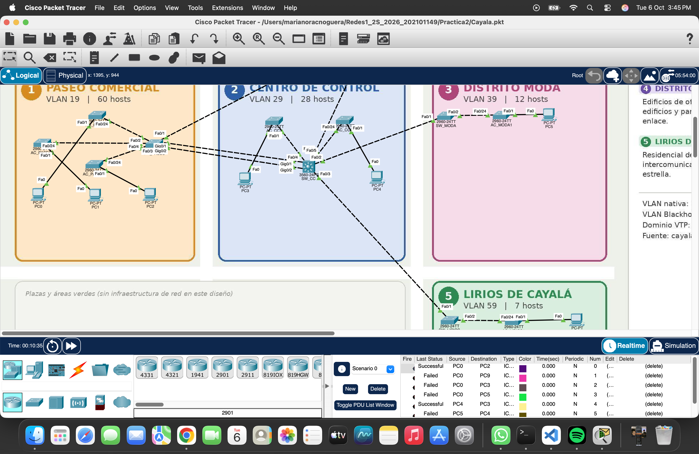
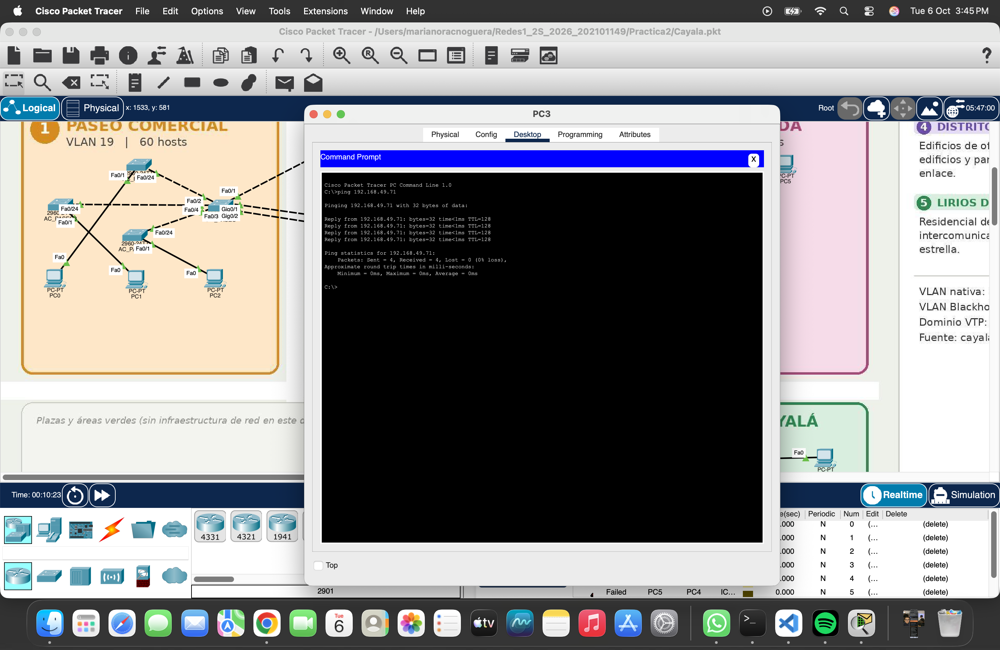

# Informe de Desarrollo, Práctica 2

**Red de servicios comunes de Ciudad Cayalá**

| Dato | Valor |
|---|---|
| Estudiante | Mariano Roberto Rac Noguera |
| Carné | 202101149 |
| Carrera | Ingeniería en Ciencias y Sistemas, USAC |
| Curso | Redes de Computadoras 1, segundo semestre 2026 |
| Documentos relacionados | [Manual Técnico](Manual_Tecnico.md), [README](README.md) |

## 1. Introducción

Este informe relata cómo se implementó en Cisco Packet Tracer la red de servicios comunes de Ciudad Cayalá, en el orden en que se hizo. También describe los problemas que surgieron, cómo se resolvieron y las pruebas que demuestran que la red funciona. El detalle técnico de cada componente (VLANs, VTP, EtherChannel, STP, direccionamiento y alcance de capa 2) está en el [Manual Técnico](Manual_Tecnico.md), y los comandos están en los scripts `.conf` de esta carpeta.

La red conecta cinco zonas del complejo (Paseo Comercial, Centro de Control, Distrito Moda, Distrito Empresarial y Lirios Residencial) con 15 switches. El núcleo es un Cisco 3560 en el Centro de Control que funciona como switch núcleo de capa 2, y en el centro de la topología hay un triángulo redundante con un EtherChannel PAgP hacia la zona de más tráfico. Por indicación del auxiliar del curso, la práctica es solo de capa 2. No hay enrutamiento entre VLANs y todas las PCs están en la misma red, 192.168.49.0/24, de modo que lo único que separa a las zonas son las VLANs.

## 2. Implementación en orden

### 2.1 Diseño y cableado

Primero se definieron las zonas, sus VLANs y sus cantidades de hosts a partir de fuentes públicas sobre Cayalá, partiendo de la premisa de que la red es del administrador del complejo y no de los inquilinos. Con eso se dimensionaron los switches de acceso, dividiendo los hosts de cada zona entre los 23 puertos libres de un 2960 y redondeando hacia arriba, lo que dio 10 accesos. Luego se dibujó el plano esquemático de zonas como fondo de Packet Tracer y se colocaron los 15 switches y las 10 PCs de prueba.

El cableado siguió la tabla del Manual Técnico. Se usó crossover entre switches y straight-through entre cada acceso y su PC, y los dos puertos Gigabit de SW_CC y SW_PASEO quedaron reservados para el EtherChannel.


*Figura 1. Topología cableada en Packet Tracer sobre el plano de zonas. Se distinguen el triángulo SW_CC, SW_PASEO y SW_EMP, los dos cables Gigabit hacia la Zona 1 y las zonas 3 y 5 en estrella.*


*Figura 2. Vista completa del diseño final con las cinco zonas, sus switches de acceso y las PCs de prueba PC0 a PC9.*

### 2.2 VTP antes que todo

Antes de crear cualquier VLAN se configuró VTP en los 15 switches. Los cinco principales se pusieron en modo servidor con [`SW_CC.conf`](SW_CC.conf) y los diez accesos en modo cliente con [`SW_AC.conf`](SW_AC.conf), todos con el dominio 202101149 y la contraseña PRAC2. Se hizo en este orden por el riesgo de tener cinco servidores en un mismo dominio, ya que todos adoptan la base de datos con el número de revisión más alto. Al configurar VTP con todas las revisiones en 0 y crear las VLANs después en un solo servidor, SW_CC quedó como la única fuente de VLANs.


*Figura 3. AC_EMP2 se configura como cliente VTP y cambia su dominio de NULL a 202101149.*

### 2.3 Creación de VLANs en SW_CC

Con VTP listo, se crearon las siete VLANs (19, 29, 39, 49, 59, 99 y 999) solo en SW_CC con [`SW_CC_VLANS.conf`](SW_CC_VLANS.conf). Justo antes, `show vtp status` mostraba la revisión 0, que confirma que nadie había modificado la base antes.


*Figura 4. Revisión de configuración 0 en SW_CC, creación de las siete VLANs y `show vlan brief` con todas activas.*

### 2.4 Troncales y EtherChannel

Después se configuraron los troncales 802.1Q con nativa 99 y el EtherChannel PAgP entre SW_CC y SW_PASEO, con [`SW_CC_TRUNKS.conf`](SW_CC_TRUNKS.conf), [`SW_PASEO.conf`](SW_PASEO.conf), [`SW_EMP.conf`](SW_EMP.conf) y [`SW_LIRIOS.conf`](SW_LIRIOS.conf), además de los troncales de SW_MODA y el uplink Fa0/24 de cada acceso. En esta etapa aparecieron los problemas 1, 2 y 3 de la sección 3. Una vez resueltos, `show etherchannel summary` mostró `Po1(SU)` con ambos miembros en `(P)` y las VLANs llegaron a todos los switches.


*Figura 5. `Po1(SU)` con PAgP y `Gig0/1(P)` y `Gig0/2(P)`, y los seis troncales de SW_CC con nativa 99. Todavía se ven los avisos de nativa no coincidente en Fa0/4 y Fa0/5 y el prompt genérico `Switch`, porque el hostname aún no estaba configurado.*

### 2.5 Configuración base, STP, accesos y Blackhole

En cada switch se configuró el hostname, `no ip domain-lookup` y Rapid PVST+. En los principales se fijaron las prioridades de STP para que cada uno sea root de su VLAN y SW_CC sea root de la 29 y la 99 y respaldo de las demás ([`SW_CC_vtP.conf`](SW_CC_vtP.conf) en el núcleo). En los accesos, siguiendo la plantilla [`AC_EMP3.conf`](AC_EMP3.conf), el puerto Fa0/1 quedó en la VLAN de la zona con PortFast y el uplink Fa0/24 como troncal. En todos los switches los puertos sin uso pasaron a la VLAN 999 y se apagaron.


*Figura 6. AC_CC1 con su uplink troncal, Fa0/1 en la VLAN 29 con PortFast y los puertos libres en la Blackhole.*


*Figura 7. AC_EMP1 apaga Fa0/2 a Fa0/23 y Gig0/1 a Gig0/2, y STP informa "Port consistency restored" en Fa0/24 para las VLANs 99 y 1.*


*Figura 8. SW_LIRIOS recibe su hostname, Rapid PVST+, prioridad 4096 en la VLAN 59 y la Blackhole en sus puertos libres.*

### 2.6 Restricción de VLANs permitidas

Con la propagación de VTP ya verificada, se limitó cada troncal a las VLANs que necesita (por ejemplo 39 y 99 en Distrito Moda, y 19, 49 y 99 en el triángulo). Se dejó para el final de la configuración de capa 2 para aislar fallas. Si algo dejaba de funcionar, la causa estaba en la restricción y no en VTP.


*Figura 9. SW_MODA aplica [`SW_MODA_ALLOWD_VLANS.conf`](SW_MODA_ALLOWD_VLANS.conf) y limita sus dos troncales a las VLANs 39 y 99.*


*Figura 10. AC_LIRIOS1 limita su uplink a las VLANs 59 y 99.*

### 2.7 Direccionamiento de las PCs

Se asignó a cada PC una IP estática de la red 192.168.49.0/24, con máscara 255.255.255.0 y gateway 192.168.49.1, dentro del rango reservado para su zona (tabla completa en la sección 12 del Manual Técnico). Todas las PCs quedaron en la misma red IP por indicación del auxiliar, ya que la práctica es solo de capa 2. Así, la única barrera entre zonas es la separación de VLANs. El gateway se configuró porque el enunciado lo pide, pero ningún equipo tiene esa dirección y las PCs no lo usan, porque todos sus destinos están en su propia red. La configuración de PC0 aparece en la Figura 16.

### 2.8 Eliminación del enrutamiento en SW_CC

La primera versión de la práctica tenía enrutamiento inter-VLAN en SW_CC. Al saberse que la práctica es solo de capa 2, se aplicó [`VOLVIENDO_A_CAPA2.conf`](VOLVIENDO_A_CAPA2.conf), que desactiva `ip routing` y elimina las cinco SVIs. SW_CC quedó como switch núcleo de capa 2, y siguió siendo el servidor VTP, el root bridge de las VLANs 29 y 99 y el extremo del EtherChannel PAgP. El cambio y sus efectos se describen como problema 6 en la sección 3.6.

## 3. Problemas encontrados y soluciones

### 3.1 EtherChannel en estado SD con miembros stand-alone

**Síntoma.** Tras configurar el EtherChannel, `show etherchannel summary` mostraba `Po1(SD)` con `Gig0/1(I)` y `Gig0/2(I)`. La S indica capa 2, la D indica que el canal está caído y la I indica que los puertos quedaron stand-alone, funcionando como enlaces sueltos fuera del canal.

**Causa.** Los puertos se agregaron al canal con `channel-group 1 mode desirable` antes de que el otro extremo estuviera configurado. PAgP intentó negociar, no recibió respuesta y dejó los puertos como individuales, y no volvió a intentar la negociación por sí solo.

**Solución.** Se forzó la renegociación guardando la configuración, cerrando y reabriendo el archivo de Packet Tracer, lo que equivale a hacer `shutdown` y `no shutdown` en los miembros. Al levantarse con ambos extremos ya configurados, PAgP completó la negociación y quedó `Po1(SU)` con ambos miembros en `(P)` (Figura 5). Era el mismo síntoma que se presentó en el Proyecto 1, y la lección es configurar los dos extremos antes de activar los puertos o reiniciarlos después.

```
! Equivalent fix by CLI on both ends of the channel
interface range GigabitEthernet0/1 - 2
 shutdown
 no shutdown
 end
show etherchannel summary
```


*Figura 11 (pendiente). `show etherchannel summary` con `Po1(SD)`, `Gig0/1(I)` y `Gig0/2(I)` antes de la corrección.*

### 3.2 Las VLANs no se propagaban por VTP

**Síntoma.** Las VLANs creadas en SW_CC no aparecían en los demás switches.

**Causa.** VTP solo envía sus anuncios por enlaces troncales, y en ese momento los enlaces entre switches seguían en modo acceso o en negociación dinámica sin llegar a formar troncal.

**Solución.** Se configuró `switchport mode trunk` explícitamente en **ambos** extremos de cada enlace entre switches (en el 3560, precedido de `switchport trunk encapsulation dot1q`). Con los troncales activos, los anuncios llegaron y `show vlan brief` mostró las siete VLANs en los clientes.

### 3.3 Nativa no coincidente y bloqueo por STP en Fa0/4 y Fa0/5 de SW_CC

**Síntoma.** SW_CC mostraba `%CDP-4-NATIVE_VLAN_MISMATCH` en Fa0/4 y Fa0/5 (nativa 99 local contra nativa 1 en Fa0/24 del vecino), y STP bloqueaba las VLANs 1 y 99 en esos puertos por inconsistencia.

**Causa.** SW_CC ya tenía nativa 99 en sus troncales, pero los switches de acceso AC_CC1 y AC_CC2 todavía tenían la nativa por defecto (VLAN 1) en su uplink. Una nativa distinta en cada extremo mezcla el tráfico sin etiqueta de dos VLANs, y STP bloquea el puerto para evitar un bucle entre ellas.

**Solución.** Se configuró `switchport trunk native vlan 99` en Fa0/24 de los accesos. Al coincidir ambos extremos, STP emitió "Port consistency restored" para las VLANs 99 y 1 y los puertos volvieron a reenviar.


*Figura 12. Avisos `%CDP-4-NATIVE_VLAN_MISMATCH` en Fa0/4 y Fa0/5 de SW_CC (nativa 99) contra Fa0/24 de los accesos (nativa 1).*


*Figura 13. Mismo efecto observado en AC_EMP1, que también tenía nativa 1 al principio. Después de configurar la nativa 99 en su uplink, STP informa `UNBLOCK_CONSIST_PORT ... Port consistency restored` en Fa0/24 para las VLANs 99 y 1.*

### 3.4 Hostnames por defecto

**Síntoma.** Los mensajes de CDP decían "with Switch FastEthernet0/24", y como todos los switches se llamaban `Switch` no se sabía de cuál venía cada aviso.

**Solución.** Se configuró el hostname en los 15 switches por CLI (`hostname SW_CC`, `hostname AC_CC1` y así sucesivamente). Desde entonces cada mensaje identifica al vecino. En las Figuras 4 y 5 todavía se ve el prompt `Switch`, y en las Figuras 6 a 10 ya aparecen los nombres definitivos.

### 3.5 Gig0/1 y Gig0/2 de SW_EMP fuera de la Blackhole

**Síntoma.** En la planificación inicial del rango de la Blackhole de SW_EMP solo se incluyeron puertos FastEthernet libres, y se omitieron los puertos Gig0/1 y Gig0/2, que en ese switch no se usan (el EtherChannel está en SW_PASEO, no en SW_EMP).

**Solución.** Se corrigió el rango para incluir `GigabitEthernet0/1 - 2`. La regla que se adoptó es revisar la tabla de cableado de cada switch y enviar a la Blackhole todo puerto que no aparezca en ella, ya sea FastEthernet o Gigabit.

```
! SW_EMP, corrected blackhole range
interface range FastEthernet0/6 - 24 , GigabitEthernet0/1 - 2
 description UNUSED_BLACKHOLE
 switchport mode access
 switchport access vlan 999
 shutdown
 exit
```

### 3.6 La práctica debía ser solo de capa 2

**Síntoma.** La primera versión implementaba enrutamiento inter-VLAN en SW_CC, con `ip routing`, una SVI por zona y una subred distinta para cada VLAN. Con esa configuración los pings entre zonas eran exitosos. El auxiliar del curso indicó que esta práctica es solo de capa 2, así que ese diseño no correspondía a lo pedido.

**Causa.** Se interpretó que el enunciado pedía comunicar las zonas entre sí, cuando el objetivo de la práctica es la segmentación de capa 2 (VLANs, VTP, troncales, EtherChannel y STP).

**Solución.** Se aplicó [`VOLVIENDO_A_CAPA2.conf`](VOLVIENDO_A_CAPA2.conf) en SW_CC, que ejecuta `no ip routing` y elimina las SVIs Vlan19, Vlan29, Vlan39, Vlan49 y Vlan59, y se migró el direccionamiento de todas las PCs a la red única 192.168.49.0/24, con un rango reservado por zona. El auxiliar pidió la misma red para todas las PCs para poder probar pings que no deberían funcionar. Con una sola red IP, lo único que puede impedir un ping entre zonas es la separación de VLANs.

**Efecto en las pruebas.** Los pings entre zonas pasaron de exitosos a fallidos, y ese es el comportamiento correcto en capa 2. Los pings dentro de una misma VLAN siguen funcionando, incluso entre switches de acceso distintos. La explicación detallada de por qué falla el ping entre zonas está en la sección 13.3 del Manual Técnico.

Antes de activar el enrutamiento, en la primera versión ya se había hecho una prueba de control con el direccionamiento por subredes, en la que la misma VLAN se comunicaba y VLANs distintas no. Esa prueba mostraba el mismo patrón que las pruebas actuales, pero en ese momento la falla entre VLANs tenía dos causas posibles (redes IP distintas y VLANs distintas). Con el nuevo direccionamiento la falla solo puede atribuirse a la VLAN (sección 4.2).


*Figura 14. Prueba de control de la primera versión, antes de activar el enrutamiento, con PDUs simples. PC3 a PC4 (ambas en la VLAN 29) es Successful, y PC5 (VLAN 39) a PC6 (VLAN 59) es Failed.*


*Figura 15. Detalle de la lista de PDUs de la prueba de control de la primera versión.*

## 4. Pruebas de funcionamiento

Todas las pruebas se hicieron con el direccionamiento 192.168.49.0/24 y sin enrutamiento en SW_CC. Como todas las PCs están en la misma red IP, un ping exitoso confirma que existe camino de capa 2 en la VLAN, y un ping fallido entre zonas confirma que las VLANs separan los dominios de broadcast.

### 4.1 Configuración IP de las PCs

Primero se verificó en cada PC la IP, la máscara y el gateway de la tabla de direccionamiento.


*Figura 16. PC0 (Zona 1, VLAN 19) con configuración estática 192.168.49.10, máscara 255.255.255.0 y gateway 192.168.49.1.*

### 4.2 Pruebas de conectividad

| Desde | Hacia | Comando | Resultado esperado | Motivo |
|---|---|---|---|---|
| PC0 (VLAN 19) | PC1 | `ping 192.168.49.11` | Éxito | Misma VLAN, distintos switches de acceso |
| PC3 (VLAN 29) | PC4 | `ping 192.168.49.71` | Éxito | Misma VLAN, cruza SW_CC |
| PC7 (VLAN 49) | PC9 | `ping 192.168.49.122` | Éxito | Misma VLAN |
| PC0 (VLAN 19) | PC7 | `ping 192.168.49.120` | Falla | VLANs distintas |
| PC6 (VLAN 59) | PC3 | `ping 192.168.49.70` | Falla | VLANs distintas |

Un ping entre zonas falla aunque ambas PCs estén en 192.168.49.0/24. La PC origen ve el destino en su propia red, no usa el gateway y envía un ARP de broadcast para obtener la MAC del destino. Ese broadcast solo circula dentro de su VLAN, porque cada VLAN es un dominio de broadcast distinto y no hay ningún dispositivo de capa 3 que las una. El ARP nunca llega a la otra VLAN, la PC nunca obtiene la MAC destino y el ping termina en "Request timed out". Dentro de la misma VLAN el ping sí funciona aunque las PCs estén en switches de acceso distintos, porque los troncales transportan esa VLAN (sección 13.3 del Manual Técnico).

Además de la tabla, se enviaron PDUs simples (ICMP) en modo simulación entre pares de la misma zona y de zonas distintas.



*Figura 17. PDUs simples con el nuevo direccionamiento. PC0 a PC2 (VLAN 19) y PC4 a PC3 (VLAN 29) son Successful, porque cada par está en la misma VLAN. PC0 (VLAN 19) a PC9 (VLAN 49), PC0 a PC3 (VLAN 29), PC0 a PC5 (VLAN 39) y PC5 (VLAN 39) a PC4 (VLAN 29) son Failed, porque cada par está en VLANs distintas aunque todas las PCs estén en la misma red IP.*

### 4.3 Pruebas por Command Prompt

Después se repitieron las pruebas desde el Command Prompt de las PCs. El ping de PC3 a PC4, ambas en la VLAN 29 pero en switches de acceso distintos (AC_CC1 y AC_CC2), responde con **TTL=128**. Es el valor con el que envía una PC de Packet Tracer, y llega sin reducir porque el tráfico cruza SW_CC solo en capa 2 y ningún equipo lo enruta.



*Figura 18. `ping 192.168.49.71` desde PC3 (VLAN 29, AC_CC1) hacia PC4 (VLAN 29, AC_CC2) con 4 respuestas, TTL=128 y 0 % de pérdida.*

### 4.4 Comandos de verificación en los switches

| Comando | Qué verifica | Evidencia |
|---|---|---|
| `show ip interface brief` | SW_CC sin interfaces Vlan después de quitar las SVIs | Pendiente, Figura 19 |
| `show ip route` | SW_CC sin rutas, porque el enrutamiento está desactivado | Pendiente, Figura 19 |
| `show etherchannel summary` | `Po1(SU)` con PAgP y miembros `(P)` | Figura 5 |
| `show interfaces trunk` | Troncales 802.1Q, nativa 99 y VLANs permitidas | Figura 5 (antes de la restricción) |
| `show vtp status` | Dominio, modo y revisión | Figura 4 (revisión 0 antes de crear VLANs) |
| `show vlan brief` | Las siete VLANs presentes | Figuras 4 y 5 |
| `show spanning-tree vlan X` | Root bridge y roles de puerto por VLAN | Pendiente, Figuras 20 y 21 |

El enunciado menciona `show ip route` como evidencia de enrutamiento. Por la indicación del auxiliar, el 3560 no enruta en esta práctica, así que no hay tabla de rutas que mostrar como evidencia de enrutamiento. La salida de `show ip route` y de `show ip interface brief` sin interfaces Vlan sirve, en cambio, como evidencia de que el enrutamiento está desactivado.


*Figura 19 (pendiente). `show ip route` y `show ip interface brief` en SW_CC después de aplicar `VOLVIENDO_A_CAPA2.conf`, sin rutas C y sin interfaces Vlan19, Vlan29, Vlan39, Vlan49 ni Vlan59.*


*Figura 20 (pendiente). `show vtp status` en un switch cliente después de la propagación, con el dominio 202101149, modo Client y la misma revisión que SW_CC.*


*Figura 21 (pendiente). `show spanning-tree vlan 19` en SW_PASEO con "This bridge is the root" y prioridad 4115.*

### 4.5 Prueba de redundancia

Como ya no hay tráfico entre zonas, la redundancia del triángulo se prueba observando STP. La prueba tiene dos partes.

**Caída del EtherChannel completo.** En la VLAN 99 el root bridge es SW_CC, y SW_PASEO llega a él por Po1, que es su root port. El camino de respaldo es Fa0/1 de SW_PASEO hacia SW_EMP, y de ahí por Fa0/1 de SW_EMP hacia SW_CC. Se ejecuta `show spanning-tree vlan 99` en SW_PASEO antes de la prueba, se apaga Po1 en SW_CC y se repite el comando.

```
! On SW_PASEO, before the test
show spanning-tree vlan 99
! On SW_CC, bring the EtherChannel down
configure terminal
interface Port-channel1
 shutdown
 end
! On SW_PASEO, after the test
show spanning-tree vlan 99
! On SW_CC, restore afterwards
configure terminal
interface Port-channel1
 no shutdown
 end
```

Lo esperado es que el root port de SW_PASEO pase de **Po1** a **Fa0/1**, el camino de respaldo por SW_EMP. Para que ese camino quede activo, Fa0/2 de SW_EMP, que en la VLAN 99 estaba como Alternate (Manual Técnico, sección 10.5), debe pasar a forwarding. Rapid PVST+ hace este cambio en uno o dos segundos.


*Figura 22 (pendiente). `show spanning-tree vlan 99` en SW_PASEO antes de la prueba, con SW_CC como root (prioridad 4195) y Po1 como Root FWD.*


*Figura 23 (pendiente). `show spanning-tree vlan 99` en SW_PASEO después de apagar Po1 en SW_CC, con Fa0/1 como Root FWD y Po1 fuera de la lista de puertos.*

**Caída de un solo miembro del EtherChannel.** Se apaga solo Gig0/1 en SW_CC. El canal debe seguir arriba con Gig0/2 y STP no debe recalcular, porque sigue viendo a Po1 como un único enlace activo. En SW_PASEO, `show spanning-tree vlan 99` debe seguir mostrando Po1 como root port.

```
! On SW_CC
configure terminal
interface GigabitEthernet0/1
 shutdown
 end
show etherchannel summary
! On SW_PASEO, Po1 must remain the root port
show spanning-tree vlan 99
! On SW_CC, restore afterwards
configure terminal
interface GigabitEthernet0/1
 no shutdown
 end
```


*Figura 24 (pendiente). `show etherchannel summary` con `Po1(SU)`, `Gig0/1(D)` y `Gig0/2(P)`, y Po1 todavía como root port de SW_PASEO en la VLAN 99.*

## 5. Conclusiones

La red quedó funcionando como una red de capa 2 con las cinco zonas segmentadas en sus VLANs. Con todas las PCs en la misma red IP, los pings dentro de cada VLAN funcionan y los pings entre zonas fallan, lo que demuestra que la separación la hacen solo las VLANs. Las decisiones que más pesaron fueron tres. Separar criticidad de cantidad de hosts, que llevó a poner el núcleo en una zona pequeña y el EtherChannel en la de más tráfico. Configurar VTP en todos los switches antes de crear las VLANs, que neutralizó el riesgo de tener cinco servidores. Y fijar las prioridades de STP por VLAN, que hace predecible la elección del root y reparte la carga del triángulo. Los problemas de configuración encontrados (negociación de PAgP, troncales no formados, nativa no coincidente, hostnames y un rango de la Blackhole incompleto) tuvieron en común que se resolvieron revisando ambos extremos de cada enlace, y esa es la principal lección técnica de la práctica. El sexto problema, el enrutamiento que no correspondía al alcance, dejó otra lección: verificar el alcance de la práctica antes de agregar funciones que no se piden.

## 6. Verificación contra el enunciado

| Exigencia del enunciado para el Informe de Desarrollo | Dónde se cubre | Estado |
|---|---|---|
| Texto que explique la implementación | Sección 2, en el orden en que se hizo | Cubierto |
| Problemas encontrados | Sección 3, seis problemas con síntoma y causa | Cubierto |
| Soluciones adoptadas | Sección 3, solución de cada problema | Cubierto |
| Capturas del correcto funcionamiento | Secciones 2, 3 y 4 con las capturas del repositorio | Cubierto, con marcadores pendientes para EtherChannel en SD, SW_CC sin enrutamiento, VTP en cliente, STP y redundancia |
