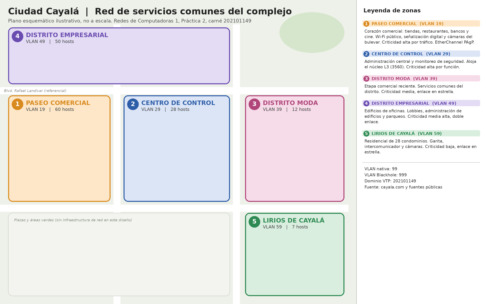
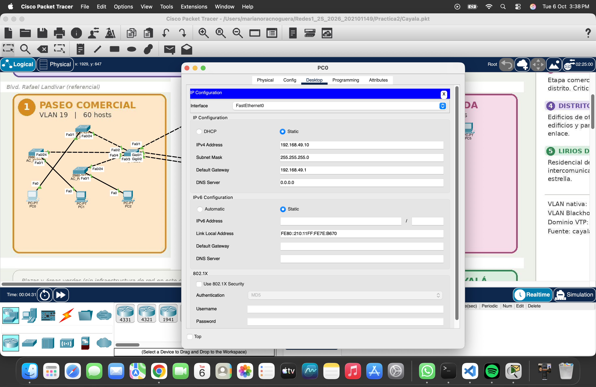

# Manual Técnico, Práctica 2

**Red de servicios comunes de Ciudad Cayalá**

| Dato | Valor |
|---|---|
| Estudiante | Mariano Roberto Rac Noguera |
| Carné | 202101149 |
| Carrera | Ingeniería en Ciencias y Sistemas |
| Universidad | Universidad de San Carlos de Guatemala (USAC), Facultad de Ingeniería |
| Curso | Redes de Computadoras 1, segundo semestre 2026 |
| Herramienta | Cisco Packet Tracer, archivo [`Cayala.pkt`](Cayala.pkt) |

## 1. Premisa de diseño

La red diseñada pertenece a la empresa administradora de Ciudad Cayalá (zona 16 de la Ciudad de Guatemala), no a los inquilinos. Cada tienda, oficina o apartamento contrata su propio proveedor de internet, por lo que esta red no los conecta a ellos. Lo que cubre son los servicios comunes del complejo, es decir el Wi-Fi público, la señalización digital, las cámaras, el control de accesos, la administración de edificios y los parqueos. Esta premisa explica por qué las cantidades de hosts son moderadas (157 en total) en un complejo que tiene más de 200 comercios.

Por indicación del auxiliar del curso, la práctica es solo de capa 2. No hay enrutamiento entre VLANs y todas las PCs comparten la red 192.168.49.0/24, de modo que la separación entre zonas depende únicamente de las VLANs. La decisión y sus consecuencias se explican en la sección 13.

El escenario se construyó con fuentes públicas. El sitio oficial [cayala.com](https://www.cayala.com) presenta un directorio de más de 200 comercios organizados en las categorías Comercio, Gastronomía, Entretenimiento, Salud y Servicios, y da como dirección de contacto Blvd. Rafael Landívar 10-05, zona 16. Diversos artículos públicos y el artículo de Wikipedia sobre [Ciudad Cayalá](https://es.wikipedia.org/wiki/Ciudad_Cayal%C3%A1) describen Paseo Cayalá como el corazón comercial del proyecto, además de Distrito Moda, el Distrito Empresarial de 13 edificios de oficinas, el hotel AC Marriott y el residencial Lirios de Cayalá de 28 condominios, y mencionan seguridad con cámaras y control de acceso.

El Centro de Control como zona de red es un **supuesto de diseño**, no un dato verificado. Es razonable porque un complejo de este tamaño tiene una administración central identificable, pero su ubicación física y su tamaño exactos no provienen de ninguna fuente.

## 2. Zonas y criticidad

| Zona | Nombre | VLAN | Hosts | Rol | Criticidad | Tipo de conexión |
|---|---|---|---|---|---|---|
| 1 | PASEO_COMERCIAL | 19 | 60 | Corazón comercial con Wi-Fi público, señalización digital, kioscos y cámaras del bulevar | Alta por tráfico | EtherChannel PAgP de 2 enlaces Gigabit al núcleo y enlace de respaldo a la Zona 4 |
| 2 | CENTRO_CONTROL | 29 | 28 | Administración central y monitoreo de seguridad, aloja el switch núcleo de capa 2 | Alta por función | Es el núcleo, sus accesos cuelgan directo del 3560 |
| 3 | DISTRITO_MODA | 39 | 12 | Servicios comunes del distrito | Media | Estrella, un enlace al núcleo |
| 4 | DISTRITO_EMPRESARIAL | 49 | 50 | Lobbies, administración de edificios, salas compartidas y parqueos | Media alta | Doble enlace, al núcleo y a la Zona 1 |
| 5 | LIRIOS_RESIDENCIAL | 59 | 7 | Garita, intercomunicador IP, cámaras perimetrales y área social | Baja | Estrella, un enlace al núcleo |

Criticidad y cantidad de hosts no son lo mismo, y la topología lo refleja. La Zona 2 tiene solo 28 hosts, pero es crítica por función, porque ahí vive el switch núcleo de capa 2, al que llegan los troncales de todas las zonas, que es el servidor VTP desde el que se administran las VLANs y el root bridge de la VLAN nativa, y desde ahí se monitorea la seguridad del complejo. Si cae, las zonas 3 y 5 quedan sin enlace hacia el resto de la red y los dos accesos del Centro de Control quedan separados entre sí. Por eso la Zona 2 es el centro de la topología y no necesita un enlace agregado, ya que sus propios accesos cuelgan directamente del núcleo. La Zona 1, en cambio, es crítica por tráfico. Concentra el Wi-Fi público y la señalización de la zona con más visitantes, por lo que recibe el único EtherChannel Gigabit de la red y además un camino de respaldo por la Zona 4.

## 3. Topología


*Figura 1. Diseño final de la topología sobre el plano esquemático del complejo. Se ven el núcleo SW_CC (3560) en la Zona 2, el triángulo SW_CC, SW_PASEO y SW_EMP, y las zonas 3 y 5 conectadas en estrella al núcleo.*



*Figura 2. Plano esquemático de zonas usado como fondo en Packet Tracer (ilustrativo, no a escala). Indica la VLAN y la cantidad de hosts de cada zona y la ubicación referencial del Blvd. Rafael Landívar.*

### 3.1 Tipo de topología

La topología es **híbrida**. En el centro hay una malla parcial formada por el triángulo SW_CC, SW_PASEO y SW_EMP, y alrededor del núcleo hay una estrella formada por SW_MODA y SW_LIRIOS. Dentro de cada zona se usa una jerarquía de dos niveles, con un switch principal que concentra la zona y switches de acceso donde se conectan los hosts.

Se eligió así porque cada parte de la red tiene necesidades distintas. Una malla completa entre los cinco switches principales daría redundancia a zonas que no la necesitan (Lirios con 7 hosts y criticidad baja) a cambio de más cables, más puertos bloqueados por STP y más complejidad. Una estrella pura sería barata, pero dejaría a la Zona 1, la de más tráfico, dependiendo de un único camino. La malla parcial pone la redundancia solo donde la criticidad la justifica (zonas 1 y 4) y la estrella mantiene simples las zonas pequeñas.

### 3.2 Inventario de switches

| Hostname | Zona | Función | Modelo | Rol VTP |
|---|---|---|---|---|
| SW_CC | 2 | Principal y switch núcleo de capa 2 | Cisco 3560-24PS (multicapa) | Servidor |
| SW_PASEO | 1 | Principal | Cisco 2960-24TT | Servidor |
| SW_EMP | 4 | Principal | Cisco 2960-24TT | Servidor |
| SW_MODA | 3 | Principal | Cisco 2960-24TT | Servidor |
| SW_LIRIOS | 5 | Principal | Cisco 2960-24TT | Servidor |
| AC_CC1, AC_CC2 | 2 | Acceso | Cisco 2960-24TT | Cliente |
| AC_PASEO1, AC_PASEO2, AC_PASEO3 | 1 | Acceso | Cisco 2960-24TT | Cliente |
| AC_EMP1, AC_EMP2, AC_EMP3 | 4 | Acceso | Cisco 2960-24TT | Cliente |
| AC_MODA1 | 3 | Acceso | Cisco 2960-24TT | Cliente |
| AC_LIRIOS1 | 5 | Acceso | Cisco 2960-24TT | Cliente |

El 3560 es el único switch multicapa de la red. En esta práctica trabaja solo en capa 2, con el enrutamiento desactivado (sección 13), pero se mantuvo como núcleo porque es el punto donde convergen todos los troncales y porque, si más adelante se quisiera comunicar las zonas en capa 3, bastaría con activar su enrutamiento sin cambiar de equipo. Los 2960 son switches de capa 2, más baratos, y solo conmutan tramas dentro de su VLAN, que es todo lo que necesitan hacer los principales y los accesos.

### 3.3 Cantidad de switches de acceso

Cada switch de acceso usa Fa0/24 como uplink hacia su principal y deja 23 puertos FastEthernet libres para hosts. La cantidad de accesos por zona es la cantidad de hosts dividida entre 23, redondeada hacia arriba.

| Zona | Hosts | Hosts / 23 | Switches de acceso | Puertos para hosts | Puertos sobrantes |
|---|---|---|---|---|---|
| 1 | 60 | 2.61 | 3 | 69 | 9 |
| 2 | 28 | 1.22 | 2 | 46 | 18 |
| 3 | 12 | 0.52 | 1 | 23 | 11 |
| 4 | 50 | 2.17 | 3 | 69 | 19 |
| 5 | 7 | 0.30 | 1 | 23 | 16 |
| **Total** | **157** | | **10** | **230** | **73** |

En Packet Tracer se colocó una PC de prueba por switch de acceso (10 PCs en total), conectada en Fa0/1. La capacidad de la red está dimensionada para los 157 hosts reales, y las PCs de prueba solo sirven para verificar la conectividad de cada switch de acceso.

### 3.4 Cableado (TIA/EIA-568B)

| Origen | Puerto | Destino | Puerto | Cable | Enlace |
|---|---|---|---|---|---|
| SW_CC | Gig0/1 | SW_PASEO | Gig0/1 | Crossover | Troncal, Po1 PAgP |
| SW_CC | Gig0/2 | SW_PASEO | Gig0/2 | Crossover | Troncal, Po1 PAgP |
| SW_CC | Fa0/1 | SW_EMP | Fa0/1 | Crossover | Troncal |
| SW_CC | Fa0/2 | SW_MODA | Fa0/1 | Crossover | Troncal |
| SW_CC | Fa0/3 | SW_LIRIOS | Fa0/1 | Crossover | Troncal |
| SW_CC | Fa0/4 | AC_CC1 | Fa0/24 | Crossover | Troncal |
| SW_CC | Fa0/5 | AC_CC2 | Fa0/24 | Crossover | Troncal |
| SW_PASEO | Fa0/1 | SW_EMP | Fa0/2 | Crossover | Troncal de respaldo |
| SW_PASEO | Fa0/2 a Fa0/4 | AC_PASEO1 a 3 | Fa0/24 | Crossover | Troncal |
| SW_EMP | Fa0/3 a Fa0/5 | AC_EMP1 a 3 | Fa0/24 | Crossover | Troncal |
| SW_MODA | Fa0/2 | AC_MODA1 | Fa0/24 | Crossover | Troncal |
| SW_LIRIOS | Fa0/2 | AC_LIRIOS1 | Fa0/24 | Crossover | Troncal |
| Cada AC | Fa0/1 | PC de prueba | FastEthernet0 | Straight-through | Acceso |

Se usan medios distintos según la carga. El EtherChannel hacia la Zona 1 usa los dos puertos Gigabit del 3560 y del 2960, porque es la zona de mayor tráfico, y los demás enlaces usan FastEthernet. Entre equipos del mismo tipo (switch con switch) se usa cable crossover, porque ambos transmiten por los mismos pares y hay que cruzarlos. Entre switch y host se usa straight-through, porque son equipos de tipo distinto y sus pares ya están invertidos. Los switches modernos con Auto-MDIX funcionarían con cualquiera de los dos, pero se respetó la regla clásica que pide el estándar.

### 3.5 Justificación zona por zona

**Zona 1, Paseo Comercial.** Es la zona con más hosts (60) y con el tráfico más pesado, ya que el Wi-Fi público y la señalización digital generan flujos constantes hacia el núcleo. Por eso tiene tres switches de acceso, un EtherChannel de dos enlaces Gigabit hacia SW_CC, que da 2 Gbps lógicos y tolera la caída de un cable, y además un enlace FastEthernet a SW_EMP. Si el EtherChannel completo falla, el tráfico llega al núcleo pasando por la Zona 4.

**Zona 2, Centro de Control.** Aloja el núcleo SW_CC, que es al mismo tiempo el switch principal de la zona y el switch núcleo de capa 2 de toda la red. Sus dos switches de acceso se conectan directamente al 3560 porque no tiene sentido intercalar otro switch entre el núcleo y su propia zona. Es crítica por función, no por volumen.

**Zona 3, Distrito Moda.** Con 12 hosts y criticidad media, basta un enlace en estrella al núcleo y un solo switch de acceso. Un segundo enlace agregaría costo y puertos bloqueados sin un beneficio proporcional.

**Zona 4, Distrito Empresarial.** Tiene 50 hosts en lobbies, administración de los edificios de oficinas, salas compartidas y parqueos, con criticidad media alta. Tiene doble enlace, uno al núcleo y otro a la Zona 1, y así cierra el triángulo. Ese triángulo le da a la Zona 4 un camino alterno al núcleo por la Zona 1, y a la Zona 1 un camino alterno por la Zona 4.

**Zona 5, Lirios Residencial.** Con 7 hosts (garita, intercomunicador IP, cámaras perimetrales y área social) y criticidad baja, se conecta en estrella al núcleo con un enlace y un switch de acceso. Recordando la premisa del diseño, los apartamentos de los 28 condominios tienen su propio proveedor y no forman parte de esta red.

## 4. Parámetros derivados del carné

| Parámetro | Valor | Origen |
|---|---|---|
| IDs de VLAN | 19, 29, 39, 49, 59 | Número de zona seguido del último dígito del carné (9) |
| VLAN nativa | 99 (NATIVA) | Requisito del enunciado |
| VLAN Blackhole | 999 (BLACKHOLE) | Requisito del enunciado |
| Dominio VTP | 202101149 | Carné completo |
| Contraseña VTP | PRAC2 | Definida por el estudiante |
| EtherChannel | PAgP, modo `desirable` en ambos extremos | Último dígito impar (9) |
| Spanning Tree | Rapid PVST+ en los 15 switches | Requisito del enunciado |
| Direccionamiento | 192.168.49.0/24, una sola red para todas las PCs | 49 son los dos últimos dígitos del carné |

## 5. Código fuente de la práctica

Los scripts de configuración CLI están en esta misma carpeta y son la fuente de verdad de los comandos de este manual. No se modificaron.

| Script | Contenido | Se aplicó en |
|---|---|---|
| [`SW_CC.conf`](SW_CC.conf) | VTP en modo servidor, dominio y contraseña | Los 5 switches principales |
| [`SW_AC.conf`](SW_AC.conf) | VTP en modo cliente, dominio y contraseña | Los 10 switches de acceso |
| [`SW_CC_VLANS.conf`](SW_CC_VLANS.conf) | Creación y nombre de las 7 VLANs | Solo SW_CC |
| [`SW_CC_TRUNKS.conf`](SW_CC_TRUNKS.conf) | EtherChannel Po1 y troncales del núcleo | SW_CC |
| [`SW_PASEO.conf`](SW_PASEO.conf) | EtherChannel Po1 y troncales de la Zona 1 | SW_PASEO |
| [`SW_EMP.conf`](SW_EMP.conf) | Troncales de la Zona 4 | SW_EMP |
| [`SW_LIRIOS.conf`](SW_LIRIOS.conf) | Troncales de la Zona 5 | SW_LIRIOS |
| [`SW_MODA.conf`](SW_MODA.conf) | Archivo vacío en el repositorio | SW_MODA |
| [`SW_CC_vtP.conf`](SW_CC_vtP.conf) | Hostname, Rapid PVST+, prioridades STP y Blackhole del núcleo | SW_CC |
| [`AC_EMP3.conf`](AC_EMP3.conf) | Plantilla completa de un switch de acceso | AC_EMP3, y como plantilla en los demás accesos |
| [`SW_MODA_ALLOWD_VLANS.conf`](SW_MODA_ALLOWD_VLANS.conf) | VLANs permitidas en los troncales de SW_MODA | SW_MODA |
| [`VOLVIENDO_A_CAPA2.conf`](VOLVIENDO_A_CAPA2.conf) | `no ip routing` y eliminación de las cinco SVIs, para dejar el núcleo solo en capa 2 | SW_CC |

Algunas partes de la configuración no tienen script en el repositorio. Son la configuración base (hostname, STP y Blackhole) de SW_PASEO, SW_EMP, SW_MODA y SW_LIRIOS, la restricción de VLANs permitidas fuera de SW_MODA y los troncales de SW_MODA. En este manual esos bloques están marcados con el comentario `! Reconstructed, no script in the repository`. Se escribieron a partir del diseño y, cuando existe, de la captura correspondiente, y siguen exactamente el patrón de los scripts que sí existen.

En los bloques de este manual, los comentarios de los scripts que mencionan "Zona" se muestran en inglés ("Zone") para mantener un único idioma en los comentarios. Los comandos son idénticos a los de los scripts.

## 6. Tabla de VLANs

| VLAN | Nombre | Zona | Hosts | Rango reservado en 192.168.49.0/24 | Uso |
|---|---|---|---|---|---|
| 19 | PASEO_COMERCIAL | 1 | 60 | .10 a .69 | Servicios comunes del Paseo Comercial |
| 29 | CENTRO_CONTROL | 2 | 28 | .70 a .99 | Administración y monitoreo |
| 39 | DISTRITO_MODA | 3 | 12 | .100 a .119 | Servicios comunes de Distrito Moda |
| 49 | DISTRITO_EMPRESARIAL | 4 | 50 | .120 a .179 | Servicios comunes del Distrito Empresarial |
| 59 | LIRIOS_RESIDENCIAL | 5 | 7 | .180 a .189 | Garita, intercomunicador y cámaras |
| 99 | NATIVA | Todas | 0 | Sin direccionamiento | VLAN nativa de todos los troncales |
| 999 | BLACKHOLE | Todas | 0 | Sin direccionamiento | Puertos sin uso, apagados |

Los rangos son administrativos dentro de la misma red, no subredes (sección 12). Las VLANs se crearon una sola vez en SW_CC y llegaron a los demás switches por VTP.

```
! Source: SW_CC_VLANS.conf (applied only on SW_CC)
configure terminal
! Zone VLANs, native and blackhole
vlan 19
 name PASEO_COMERCIAL
vlan 29
 name CENTRO_CONTROL
vlan 39
 name DISTRITO_MODA
vlan 49
 name DISTRITO_EMPRESARIAL
vlan 59
 name LIRIOS_RESIDENCIAL
vlan 99
 name NATIVA
vlan 999
 name BLACKHOLE
 exit
end
```

La VLAN nativa es la VLAN cuyas tramas viajan sin etiqueta 802.1Q por un troncal. Se cambió de la VLAN 1 a la 99 porque la VLAN 1 es la que viene por defecto en todos los puertos y es el blanco típico de ataques de VLAN hopping por doble etiquetado. La Blackhole es una VLAN sin gateway ni hosts a la que se asignan los puertos sin uso. Si alguien conecta un equipo a un puerto libre, ese puerto está apagado y además, aunque lo encendiera, quedaría en una VLAN aislada que no llega a ningún lado.

## 7. VTP

VTP (VLAN Trunking Protocol) es un protocolo de Cisco que propaga la base de datos de VLANs (IDs y nombres) desde un servidor hacia los demás switches del mismo dominio, a través de los troncales. Un **servidor** puede crear, modificar y borrar VLANs y las anuncia. Un **cliente** no puede modificarlas y solo aplica lo que recibe. Un switch **transparente** reenvía los anuncios, pero mantiene su propia base local. El enunciado pide que cada switch principal sea servidor, así que hay cinco servidores (SW_CC, SW_PASEO, SW_EMP, SW_MODA y SW_LIRIOS) y diez clientes (los switches de acceso).

```
! Source: SW_CC.conf (same block applied on the 5 main switches)
enable
configure terminal
vtp mode server
vtp domain 202101149
vtp password PRAC2
```

```
! Source: SW_AC.conf (applied on the 10 access switches)
enable
configure terminal
vtp mode client
vtp domain 202101149
vtp password PRAC2
```

La contraseña hace que el resumen MD5 de cada anuncio dependa de ella, y un switch solo acepta anuncios cuyo MD5 coincide con el suyo. Esto evita que un switch ajeno al dominio inyecte VLANs.


*Figura 3. Configuración de VTP en modo cliente en AC_EMP2. El mensaje "Changing VTP domain name from NULL to 202101149" confirma que el switch se unió al dominio.*

**Riesgo de tener cinco servidores.** VTP no tiene un servidor maestro. Todos los switches del dominio adoptan la base de datos que llegue con el **número de revisión más alto**, sin importar quién la envió. Con cinco servidores, si uno de ellos se conecta con una revisión mayor (por ejemplo, un switch reutilizado de otro laboratorio con VLANs viejas), esa base sobrescribe la de todo el dominio y puede borrar las VLANs reales.

**Mitigación aplicada.** Se configuró VTP en todos los switches antes de crear cualquier VLAN, cuando todos tenían revisión 0 (cambiar el nombre de dominio también reinicia la revisión a 0). Después, las VLANs se crearon en un único servidor, SW_CC, que fue el único que incrementó su revisión, y los demás servidores la adoptaron. Desde entonces, cualquier cambio de VLANs se hace solo en SW_CC.


*Figura 4. En SW_CC, `show vtp status` muestra Configuration Revision 0 antes de crear las VLANs, que es la condición de la mitigación. Luego se crean las siete VLANs y `show vlan brief` confirma que existen.*

## 8. Troncales y EtherChannel PAgP

Un **troncal** (802.1Q) es un enlace que transporta varias VLANs a la vez, agregando a cada trama una etiqueta de 4 bytes con el ID de VLAN. Un puerto de **acceso**, en cambio, pertenece a una sola VLAN y no etiqueta. Todos los enlaces entre switches son troncales con nativa 99, porque cada uno debe llevar al menos su VLAN de zona y la nativa.

Un **EtherChannel** agrupa varios enlaces físicos en un solo enlace lógico (Port-channel). Suma el ancho de banda, reparte el tráfico entre los miembros y, si uno cae, el canal sigue arriba con los demás sin que STP tenga que recalcular. **PAgP** es el protocolo propietario de Cisco que negocia el canal. Su alternativa es LACP (estándar IEEE 802.3ad) y la otra opción es el modo `on`, que forma el canal sin negociar nada. Se usó PAgP porque el último dígito del carné es impar. El modo `desirable` inicia activamente la negociación, a diferencia de `auto`, que solo responde. Con `desirable` en ambos extremos el canal se forma sin depender de cuál lado arranque primero.

```
! Source: SW_CC_TRUNKS.conf (SW_CC, Cisco 3560)
enable
configure terminal

! EtherChannel member ports toward SW_PASEO
! Members must share identical settings before joining the channel
interface range GigabitEthernet0/1 - 2
 switchport trunk encapsulation dot1q
 switchport mode trunk
 switchport trunk native vlan 99
 channel-group 1 mode desirable
 no shutdown
 exit

! Logical EtherChannel interface toward SW_PASEO
interface Port-channel1
 switchport trunk encapsulation dot1q
 switchport mode trunk
 switchport trunk native vlan 99
 exit

! Trunk toward SW_EMP (Zone 4)
interface FastEthernet0/1
 description TRUNK_TO_SW_EMP
 switchport trunk encapsulation dot1q
 switchport mode trunk
 switchport trunk native vlan 99
 no shutdown
 exit

! Trunk toward SW_MODA (Zone 3)
interface FastEthernet0/2
 description TRUNK_TO_SW_MODA
 switchport trunk encapsulation dot1q
 switchport mode trunk
 switchport trunk native vlan 99
 no shutdown
 exit

! Trunk toward SW_LIRIOS (Zone 5)
interface FastEthernet0/3
 description TRUNK_TO_SW_LIRIOS
 switchport trunk encapsulation dot1q
 switchport mode trunk
 switchport trunk native vlan 99
 no shutdown
 exit

! Trunks toward the Zone 2 access switches
interface range FastEthernet0/4 - 5
 description TRUNK_TO_AC_CC
 switchport trunk encapsulation dot1q
 switchport mode trunk
 switchport trunk native vlan 99
 no shutdown
 exit

end
copy running-config startup-config

show etherchannel summary
show interface trunk
show vlan brief
```

En el 3560 hay que ejecutar `switchport trunk encapsulation dot1q` antes de `switchport mode trunk`, porque ese modelo soporta dos encapsulaciones (ISL y 802.1Q) y no acepta el modo troncal mientras la encapsulación esté en negociación automática. El 2960 solo soporta 802.1Q, por eso ese comando no existe en él.

```
! Source: SW_PASEO.conf (SW_PASEO, Cisco 2960)
enable
configure terminal

! EtherChannel member ports toward SW_CC
! Members must share identical settings before joining the channel
interface range GigabitEthernet0/1 - 2
 switchport mode trunk
 switchport trunk native vlan 99
 channel-group 1 mode desirable
 no shutdown
 exit

! Logical EtherChannel interface toward SW_CC
interface Port-channel1
 switchport mode trunk
 switchport trunk native vlan 99
 exit

! Backup trunk toward SW_EMP (Zone 4)
interface FastEthernet0/1
 description TRUNK_TO_SW_EMP
 switchport mode trunk
 switchport trunk native vlan 99
 no shutdown
 exit

! Trunks toward the Zone 1 access switches
interface range FastEthernet0/2 - 4
 description TRUNK_TO_AC_PASEO
 switchport mode trunk
 switchport trunk native vlan 99
 no shutdown
 exit

end
copy running-config startup-config
```

```
! Source: SW_EMP.conf (SW_EMP, Cisco 2960)
enable
configure terminal

! Trunk toward SW_CC
interface FastEthernet0/1
 description TRUNK_TO_SW_CC
 switchport mode trunk
 switchport trunk native vlan 99
 no shutdown
 exit

! Backup trunk toward SW_PASEO (Zone 1)
interface FastEthernet0/2
 description TRUNK_TO_SW_PASEO
 switchport mode trunk
 switchport trunk native vlan 99
 no shutdown
 exit

! Trunks toward the Zone 4 access switches
interface range FastEthernet0/3 - 5
 description TRUNK_TO_AC_EMP
 switchport mode trunk
 switchport trunk native vlan 99
 no shutdown
 exit

end
copy running-config startup-config
```

```
! Source: SW_LIRIOS.conf (SW_LIRIOS, Cisco 2960)
enable
configure terminal

! Trunk toward SW_CC
interface FastEthernet0/1
 description TRUNK_TO_SW_CC
 switchport mode trunk
 switchport trunk native vlan 99
 no shutdown
 exit

! Trunk toward the Zone 5 access switch
interface FastEthernet0/2
 description TRUNK_TO_AC_LIRIOS1
 switchport mode trunk
 switchport trunk native vlan 99
 no shutdown
 exit

end
copy running-config startup-config
```

```
! SW_MODA, Cisco 2960
! Reconstructed, no script in the repository (SW_MODA.conf is empty)
enable
configure terminal

! Trunk toward SW_CC
interface FastEthernet0/1
 description TRUNK_TO_SW_CC
 switchport mode trunk
 switchport trunk native vlan 99
 no shutdown
 exit

! Trunk toward the Zone 3 access switch
interface FastEthernet0/2
 description TRUNK_TO_AC_MODA1
 switchport mode trunk
 switchport trunk native vlan 99
 no shutdown
 exit

end
copy running-config startup-config
```

En los switches de acceso el uplink Fa0/24 se configura como troncal con nativa 99, tal como aparece en la plantilla [`AC_EMP3.conf`](AC_EMP3.conf) (sección 11).


*Figura 5. En SW_CC, `show etherchannel summary` muestra `Po1(SU)` con protocolo PAgP y los miembros `Gig0/1(P)` y `Gig0/2(P)`, es decir un canal de capa 2 en uso con ambos puertos agrupados. `show interface trunk` lista Po1 y Fa0/1 a Fa0/5 como troncales 802.1Q con nativa 99. En esta etapa todavía se permiten las VLANs 1 a 1005 y aparecen los mensajes `%CDP-4-NATIVE_VLAN_MISMATCH` en Fa0/4 y Fa0/5, que se corrigieron después (ver el Informe de Desarrollo).*

## 9. Restricción de VLANs permitidas

Por defecto un troncal deja pasar todas las VLANs. Se restringió cada troncal a las VLANs que realmente necesita, por tres razones. Así cada broadcast viaja solo hacia donde hay hosts de su VLAN, una VLAN no puede aparecer por error en una zona que no le corresponde y los switches que no tienen una VLAN no participan en su instancia de STP.

| Enlace | VLANs permitidas | Razón |
|---|---|---|
| Triángulo (SW_CC a SW_PASEO por Po1, SW_CC a SW_EMP, SW_PASEO a SW_EMP) | 19, 49, 99 | Camino normal y de respaldo de las zonas 1 y 4 |
| SW_CC con SW_MODA y SW_MODA con AC_MODA1 | 39, 99 | Solo su zona |
| SW_CC con SW_LIRIOS y SW_LIRIOS con AC_LIRIOS1 | 59, 99 | Solo su zona |
| SW_CC con AC_CC1 y AC_CC2 | 29, 99 | La VLAN 29 vive en SW_CC y sus accesos |
| Principales con sus accesos (PASEO y EMP) | VLAN de la zona y 99 | El acceso solo necesita su zona |

La VLAN 999 y la VLAN 1 no viajan por ningún troncal. Aun así, los protocolos de control de Cisco (CDP, VTP, PAgP y DTP) siguen usando la VLAN 1 internamente aunque no esté en la lista permitida, por eso VTP continúa funcionando después de la restricción. La restricción se aplicó al final de la configuración de capa 2, después de verificar que VTP había propagado las VLANs. Así, si algo fallaba, se sabía que la causa era la restricción y no la propagación.

```
! Source: SW_MODA_ALLOWD_VLANS.conf (SW_MODA)
enable
configure terminal
! TRUNK_TO_SW_CC: only VLANs 39,99
interface FastEthernet0/1
 switchport trunk allowed vlan 39,99
 exit
! TRUNK_TO_AC_MODA1: only VLANs 39,99
interface FastEthernet0/2
 switchport trunk allowed vlan 39,99
 exit
end
copy running-config startup-config
```

```
! SW_CC
! Reconstructed, no script in the repository
enable
configure terminal
! Triangle: Po1 toward SW_PASEO and Fa0/1 toward SW_EMP
interface Port-channel1
 switchport trunk allowed vlan 19,49,99
 exit
interface FastEthernet0/1
 switchport trunk allowed vlan 19,49,99
 exit
! Star links toward SW_MODA and SW_LIRIOS
interface FastEthernet0/2
 switchport trunk allowed vlan 39,99
 exit
interface FastEthernet0/3
 switchport trunk allowed vlan 59,99
 exit
! Zone 2 access switches
interface range FastEthernet0/4 - 5
 switchport trunk allowed vlan 29,99
 exit
end
copy running-config startup-config
```

```
! SW_PASEO
! Reconstructed, no script in the repository
enable
configure terminal
interface Port-channel1
 switchport trunk allowed vlan 19,49,99
 exit
interface FastEthernet0/1
 switchport trunk allowed vlan 19,49,99
 exit
interface range FastEthernet0/2 - 4
 switchport trunk allowed vlan 19,99
 exit
end
copy running-config startup-config
```

```
! SW_EMP
! Reconstructed, no script in the repository
enable
configure terminal
interface range FastEthernet0/1 - 2
 switchport trunk allowed vlan 19,49,99
 exit
interface range FastEthernet0/3 - 5
 switchport trunk allowed vlan 49,99
 exit
end
copy running-config startup-config
```

```
! SW_LIRIOS
! Reconstructed, no script in the repository
enable
configure terminal
interface range FastEthernet0/1 - 2
 switchport trunk allowed vlan 59,99
 exit
end
copy running-config startup-config
```

```
! Access switches, uplink Fa0/24
! Reconstructed, no script in the repository (AC_LIRIOS1 shown in Figure 7)
! Use 19 on AC_PASEO1-3, 29 on AC_CC1-2, 39 on AC_MODA1, 49 on AC_EMP1-3, 59 on AC_LIRIOS1
enable
configure terminal
! UPLINK_TRUNK: only VLANs 59,99
interface FastEthernet0/24
 switchport trunk allowed vlan 59,99
 exit
end
copy running-config startup-config
```

En el EtherChannel la lista permitida se aplica sobre la interfaz lógica Port-channel1, y el switch la copia a los miembros. Si se aplicara solo a un miembro, los dos puertos quedarían con configuraciones distintas y el canal se rompería.


*Figura 6. Aplicación de `SW_MODA_ALLOWD_VLANS.conf` en SW_MODA. Los dos troncales quedan limitados a las VLANs 39 y 99.*


*Figura 7. En AC_LIRIOS1 el uplink Fa0/24 queda limitado a las VLANs 59 y 99, con lo que el acceso de la Zona 5 solo recibe su VLAN y la nativa.*

## 10. Spanning Tree y root bridges

### 10.1 Por qué hace falta STP

La topología tiene bucles físicos intencionales. El triángulo SW_CC, SW_PASEO y SW_EMP es un bucle, y los dos cables Gigabit entre SW_CC y SW_PASEO también forman un bucle mientras no estén agrupados en el EtherChannel. Ethernet no tiene un campo de tiempo de vida como el TTL de IP, así que sin STP una trama de broadcast daría vueltas por el bucle para siempre. Cada switch la reenvía por todos sus puertos y cada vuelta la multiplica, lo que se conoce como **tormenta de broadcast** y satura los enlaces en segundos. Además, las tablas MAC se vuelven inestables, porque la misma MAC de origen aparece alternadamente por puertos distintos, y los hosts reciben **tramas duplicadas**. STP resuelve esto bloqueando lógicamente los puertos necesarios para que exista un único camino activo entre cualquier par de switches, sin desconectar ningún cable. Si el camino activo falla, desbloquea el respaldo.

### 10.2 Cómo se elige el root bridge

Todos los switches intercambian BPDUs y eligen como **root bridge** al que tenga el **Bridge ID** más bajo. El Bridge ID se forma con la prioridad (4 bits configurables en múltiplos de 4096), el **extended system ID**, que es el número de VLAN, y la dirección MAC del switch. Gana el menor. Se comparan primero prioridad y VLAN, y solo si empatan decide la MAC. Por eso la prioridad que muestra `show spanning-tree` es la configurada más el ID de la VLAN.

| Switch | VLAN | Prioridad configurada | Prioridad mostrada en el Bridge ID |
|---|---|---|---|
| SW_PASEO | 19 | 4096 | 4096 + 19 = 4115 |
| SW_CC | 19 | 8192 | 8192 + 19 = 8211 |
| SW_CC | 29 | 4096 | 4096 + 29 = 4125 |
| SW_EMP | 49 | 4096 | 4096 + 49 = 4145 |
| SW_CC | 99 | 4096 | 4096 + 99 = 4195 |
| Cualquier acceso | 19 | 32768 | 32768 + 19 = 32787 |

Si se dejaran todas las prioridades en 32768, el root de cada VLAN sería el switch con la MAC más baja, que suele ser el más viejo o el que el fabricante numeró primero. Podría terminar siendo un switch de acceso, y entonces el tráfico de esa VLAN entre switches atravesaría ese switch pequeño. La prioridad se fijó explícitamente para que la elección sea **predecible** y para que el root quede en el switch principal de cada zona, como exige el enunciado.

### 10.3 Root bridges asignados

| Switch | Prioridad 4096 (root) en | Prioridad 8192 (respaldo) en |
|---|---|---|
| SW_CC | VLAN 29 y 99 | VLAN 19, 39, 49 y 59 |
| SW_PASEO | VLAN 19 | |
| SW_EMP | VLAN 49 | |
| SW_MODA | VLAN 39 | |
| SW_LIRIOS | VLAN 59 | |
| Switches de acceso | Por defecto (32768), nunca compiten | |

Cada switch principal es root de su propia VLAN porque concentra el tráfico de su zona. Así los caminos de STP salen del centro de la zona hacia sus accesos y el tráfico local no pasa por otro switch. SW_CC es root de la VLAN 29 porque es el principal de la Zona 2, y de la VLAN 99 porque es el centro físico de la red, del que salen todos los troncales. En las demás VLANs SW_CC tiene 8192, que lo convierte en **root de respaldo**. Si un switch principal falla, la elección no cae en un switch al azar, sino en el núcleo, un punto conocido y central. Los accesos se quedan en 32768 para no competir nunca.

```
! Source: SW_CC_vtP.conf (SW_CC)
enable
configure terminal
hostname SW_CC
no ip domain-lookup
! Rapid PVST+ on this switch
spanning-tree mode rapid-pvst
! Root bridge for its own zone VLAN and for the native VLAN
spanning-tree vlan 29,99 priority 4096
! Backup root for the other zone VLANs
spanning-tree vlan 19,39,49,59 priority 8192
! Unused ports isolated in the blackhole VLAN and shut down
interface range FastEthernet0/6 - 24
 description UNUSED_BLACKHOLE
 switchport mode access
 switchport access vlan 999
 shutdown
 exit
end
copy running-config startup-config
```

```
! SW_LIRIOS
! Reconstructed, no script in the repository (commands shown in Figure 8)
enable
configure terminal
hostname SW_LIRIOS
no ip domain-lookup
! Rapid PVST+ on this switch
spanning-tree mode rapid-pvst
! Root bridge for its own zone VLAN
spanning-tree vlan 59 priority 4096
! Unused ports isolated in the blackhole VLAN and shut down
interface range FastEthernet0/3 - 24 , GigabitEthernet0/1 - 2
 description UNUSED_BLACKHOLE
 switchport mode access
 switchport access vlan 999
 shutdown
 exit
end
copy running-config startup-config
```

```
! SW_PASEO
! Reconstructed, no script in the repository
enable
configure terminal
hostname SW_PASEO
no ip domain-lookup
! Rapid PVST+ on this switch
spanning-tree mode rapid-pvst
! Root bridge for its own zone VLAN
spanning-tree vlan 19 priority 4096
! Unused ports isolated in the blackhole VLAN and shut down
interface range FastEthernet0/5 - 24
 description UNUSED_BLACKHOLE
 switchport mode access
 switchport access vlan 999
 shutdown
 exit
end
copy running-config startup-config
```

```
! SW_EMP
! Reconstructed, no script in the repository
enable
configure terminal
hostname SW_EMP
no ip domain-lookup
! Rapid PVST+ on this switch
spanning-tree mode rapid-pvst
! Root bridge for its own zone VLAN
spanning-tree vlan 49 priority 4096
! Unused ports isolated in the blackhole VLAN and shut down
! GigabitEthernet0/1 - 2 are unused on this switch and must be included
interface range FastEthernet0/6 - 24 , GigabitEthernet0/1 - 2
 description UNUSED_BLACKHOLE
 switchport mode access
 switchport access vlan 999
 shutdown
 exit
end
copy running-config startup-config
```

```
! SW_MODA
! Reconstructed, no script in the repository
enable
configure terminal
hostname SW_MODA
no ip domain-lookup
! Rapid PVST+ on this switch
spanning-tree mode rapid-pvst
! Root bridge for its own zone VLAN
spanning-tree vlan 39 priority 4096
! Unused ports isolated in the blackhole VLAN and shut down
interface range FastEthernet0/3 - 24 , GigabitEthernet0/1 - 2
 description UNUSED_BLACKHOLE
 switchport mode access
 switchport access vlan 999
 shutdown
 exit
end
copy running-config startup-config
```

Los switches de acceso solo ejecutan `spanning-tree mode rapid-pvst` y conservan la prioridad por defecto (ver [`AC_EMP3.conf`](AC_EMP3.conf)).


*Figura 8. Configuración base de SW_LIRIOS con hostname, Rapid PVST+, prioridad 4096 para la VLAN 59 (root de su zona) y envío de Fa0/3 a Fa0/24 y Gig0/1 a Gig0/2 a la Blackhole, apagados.*

### 10.4 Roles y estados de puerto en Rapid PVST+

| Rol | Significado |
|---|---|
| Root port (Root) | En cada switch que no es root, el puerto con el menor costo hacia el root bridge. Hay uno solo por switch y por VLAN |
| Designated port (Desg) | En cada segmento, el puerto que ofrece el menor costo hacia el root y reenvía hacia ese segmento. Todos los puertos del root bridge son designados |
| Alternate port (Altn) | Puerto con un camino alterno hacia el root que se mantiene bloqueado. Si el root port cae, toma su lugar casi de inmediato |

| Estado | Qué hace |
|---|---|
| Discarding | No reenvía tramas ni aprende MACs. Agrupa los estados blocking, listening y disabled del STP clásico |
| Learning | Todavía no reenvía, pero ya aprende MACs para llenar la tabla |
| Forwarding | Reenvía tramas y aprende MACs |

El STP clásico (802.1D) tarda entre 30 y 50 segundos en converger, porque espera temporizadores fijos (20 segundos de max age y dos veces 15 de forward delay). Rapid PVST+ se basa en RSTP (802.1w), que negocia directamente con el vecino mediante propuestas y acuerdos y tiene puertos alternos precalculados, así que converge en uno o dos segundos. **PVST** significa Per-VLAN Spanning Tree, es decir una instancia independiente de STP por cada VLAN, con su propio root y sus propios puertos bloqueados. Esto es lo que permite tener un root distinto por zona.

### 10.5 Balanceo de carga en el triángulo

Como cada VLAN tiene su propio root, Rapid PVST+ bloquea un puerto distinto del triángulo según la VLAN. El siguiente análisis usa los costos por defecto de Cisco (19 para FastEthernet y 3 para un Port-channel de dos enlaces Gigabit) y debe confirmarse con `show spanning-tree vlan 19`, `vlan 49` y `vlan 99` en los tres switches del triángulo.

| VLAN | Root | Puerto Alternate (bloqueado) | Enlace sin tráfico para esa VLAN | Enlaces que sí usa |
|---|---|---|---|---|
| 19 | SW_PASEO | SW_EMP Fa0/1 | SW_CC a SW_EMP | Po1 y SW_PASEO a SW_EMP |
| 49 | SW_EMP | SW_PASEO Po1 | Po1 (SW_CC a SW_PASEO) | SW_CC a SW_EMP y SW_PASEO a SW_EMP |
| 99 | SW_CC | SW_EMP Fa0/2 | SW_PASEO a SW_EMP | Po1 y SW_CC a SW_EMP |

En la VLAN 19, SW_CC llega al root SW_PASEO por Po1 con costo 3, y SW_EMP llega directo por Fa0/2 con costo 19. En el segmento SW_CC a SW_EMP gana SW_CC (anuncia costo 3 contra 19), así que el puerto Fa0/1 de SW_EMP queda Alternate. En la VLAN 49 ocurre lo contrario. SW_CC y SW_PASEO llegan al root SW_EMP por sus enlaces directos, ambos con costo 19, y en Po1 el empate se resuelve por Bridge ID (8241 de SW_CC contra 32817 de SW_PASEO), así que el lado de SW_PASEO queda Alternate. El resultado es que **ningún enlace del triángulo queda ocioso para todas las VLANs**, porque cada uno transporta tráfico de al menos dos de las tres VLANs del triángulo.


*Figura 9 (pendiente). `show spanning-tree vlan 19` en SW_EMP, que debe mostrar como root a SW_PASEO con prioridad 4115, Fa0/2 como Root FWD y Fa0/1 como Altn BLK.*


*Figura 10 (pendiente). `show spanning-tree vlan 49` en SW_PASEO, que debe mostrar como root a SW_EMP con prioridad 4145, Fa0/1 como Root FWD y Po1 como Altn BLK.*

### 10.6 Relación con el EtherChannel

Antes de agruparse, los dos enlaces Gigabit entre SW_CC y SW_PASEO son dos caminos paralelos, y STP bloquearía uno de ellos, desperdiciando la mitad del ancho de banda. Una vez formado Po1, STP ve el canal como **un solo enlace lógico** con un único puerto y un único costo, así que los dos Gigabit nunca se bloquean entre sí. El reparto del tráfico entre los miembros lo hace el EtherChannel, no STP, y la caída de un miembro no provoca ningún recálculo de STP.

### 10.7 PortFast

Los puertos donde se conectan las PCs llevan `spanning-tree portfast`, que los hace pasar directamente a forwarding al conectarse, sin esperar la negociación. Un host no puede formar un bucle y no participa en STP, así que esperar no aporta nada y solo retrasaría, por ejemplo, la obtención de una dirección IP al encender. PortFast **nunca** se usa hacia otro switch, porque un puerto que reenvía de inmediato hacia un switch puede crear un bucle temporal antes de que STP lo detecte. Por eso IOS muestra la advertencia que aparece en la Figura 11.

## 11. Puertos de acceso y Blackhole

La plantilla de los switches de acceso es [`AC_EMP3.conf`](AC_EMP3.conf). En los demás accesos cambian el hostname, el destino en la descripción del uplink, la descripción del puerto de host y la VLAN de acceso.

```
! Source: AC_EMP3.conf (template for the 10 access switches)
enable
configure terminal
hostname AC_EMP3
no ip domain-lookup
! Rapid PVST+ on this switch
spanning-tree mode rapid-pvst
! Uplink trunk toward the zone main switch
interface FastEthernet0/24
 description TRUNK_TO_SW_EMP
 switchport mode trunk
 switchport trunk native vlan 99
 no shutdown
 exit
! Host port in the zone VLAN
interface FastEthernet0/1
 description HOST_DISTRITO_EMPRESARIAL
 switchport mode access
 switchport access vlan 49
 spanning-tree portfast
 no shutdown
 exit
! Unused ports isolated in the blackhole VLAN and shut down
interface range FastEthernet0/2 - 23 , GigabitEthernet0/1 - 2
 description UNUSED_BLACKHOLE
 switchport mode access
 switchport access vlan 999
 shutdown
 exit
end
copy running-config startup-config
```

| Switch de acceso | Hostname | VLAN de Fa0/1 | Descripción de Fa0/1 | Descripción de Fa0/24 |
|---|---|---|---|---|
| AC_PASEO1 a 3 | AC_PASEO1, AC_PASEO2, AC_PASEO3 | 19 | HOST_PASEO_COMERCIAL | TRUNK_TO_SW_PASEO |
| AC_CC1 y AC_CC2 | AC_CC1, AC_CC2 | 29 | HOST_CENTRO_CONTROL | TRUNK_TO_SW_CC |
| AC_MODA1 | AC_MODA1 | 39 | HOST_DISTRITO_MODA | TRUNK_TO_SW_MODA |
| AC_EMP1 a 3 | AC_EMP1, AC_EMP2, AC_EMP3 | 49 | HOST_DISTRITO_EMPRESARIAL | TRUNK_TO_SW_EMP |
| AC_LIRIOS1 | AC_LIRIOS1 | 59 | HOST_LIRIOS_RESIDENCIAL | TRUNK_TO_SW_LIRIOS |

Los valores de AC_CC1 (HOST_CENTRO_CONTROL, VLAN 29 y TRUNK_TO_SW_CC) aparecen en la Figura 11. Los de AC_EMP3 vienen de la plantilla. Para los demás accesos no hay script ni captura que muestre las descripciones, así que en esta tabla se asumieron con el mismo patrón (las VLANs sí corresponden al diseño).

En la Blackhole quedan todos los puertos que no tienen cable. El puerto se fuerza a modo acceso (para que no negocie un troncal con DTP), se asigna a la VLAN 999 y además se apaga. Son dos capas de protección, ya que encender el puerto no basta para tener acceso a la red porque además quedaría aislado en una VLAN sin gateway.

| Switch | Puertos en uso | Puertos en Blackhole |
|---|---|---|
| SW_CC | Gig0/1, Gig0/2, Fa0/1 a Fa0/5 | Fa0/6 a Fa0/24 |
| SW_PASEO | Gig0/1, Gig0/2, Fa0/1 a Fa0/4 | Fa0/5 a Fa0/24 |
| SW_EMP | Fa0/1 a Fa0/5 | Fa0/6 a Fa0/24, Gig0/1 y Gig0/2 |
| SW_MODA | Fa0/1, Fa0/2 | Fa0/3 a Fa0/24, Gig0/1 y Gig0/2 |
| SW_LIRIOS | Fa0/1, Fa0/2 | Fa0/3 a Fa0/24, Gig0/1 y Gig0/2 |
| Cada acceso | Fa0/1, Fa0/24 | Fa0/2 a Fa0/23, Gig0/1 y Gig0/2 |


*Figura 11. En AC_CC1, el uplink Fa0/24 queda como troncal con nativa 99, Fa0/1 queda en acceso en la VLAN 29 con PortFast (IOS advierte que PortFast solo debe usarse hacia hosts) y Fa0/2 a Fa0/23 y Gig0/1 a Gig0/2 pasan a la Blackhole y quedan administratively down.*


*Figura 12. En AC_EMP1, los puertos sin uso pasan a administratively down, incluidos Gig0/1 y Gig0/2. Al guardar aparece `%SPANTREE-2-UNBLOCK_CONSIST_PORT` en Fa0/24 para las VLANs 99 y 1, porque al quedar la nativa en 99 en ambos extremos STP restablece la consistencia del puerto.*

## 12. Direccionamiento IP

Todas las PCs comparten una sola red IP, **192.168.49.0/24**, donde 49 son los dos últimos dígitos del carné 202101149. Se usó una única red por indicación del auxiliar del curso, para que lo único que separe a las zonas sea la segmentación de VLANs (sección 13). La red tiene máscara 255.255.255.0, broadcast 192.168.49.255 y 254 direcciones utilizables, que alcanzan para los 157 hosts de las cinco zonas.

Dentro de esa red se reservó un rango para cada zona. Estos rangos son **administrativos, no subredes**. Todas las PCs usan la misma máscara /24, así que para cualquiera de ellas las demás PCs están en su misma red, sin importar el rango en que estén. El rango solo ordena la asignación y permite saber, con ver una IP, a qué zona pertenece el equipo (por ejemplo, 192.168.49.125 cae en el rango de la Zona 4). Cada rango cubre los hosts de su zona, y en las zonas pequeñas se redondeó hacia arriba para dejar margen de crecimiento.

| Zona | VLAN | Hosts | Rango reservado | Capacidad |
|---|---|---|---|---|
| Reservado | | | 192.168.49.1 a .9 (la .1 como gateway) | 9 |
| 1 Paseo Comercial | 19 | 60 | 192.168.49.10 a .69 | 60 |
| 2 Centro de Control | 29 | 28 | 192.168.49.70 a .99 | 30 |
| 3 Distrito Moda | 39 | 12 | 192.168.49.100 a .119 | 20 |
| 4 Distrito Empresarial | 49 | 50 | 192.168.49.120 a .179 | 60 |
| 5 Lirios de Cayalá | 59 | 7 | 192.168.49.180 a .189 | 10 |

Red 192.168.49.0, máscara 255.255.255.0, broadcast 192.168.49.255, 254 direcciones utilizables para 157 hosts. Los rangos reservados llegan hasta la .189, así que de la .190 a la .254 quedan 65 direcciones libres.

**Gateway.** El enunciado pide configurar un default gateway en cada host, así que todas las PCs tienen 192.168.49.1, la primera dirección del bloque reservado. Esa dirección queda apartada para un futuro dispositivo de capa 3 y en esta práctica ningún equipo la tiene configurada. Esto no afecta las pruebas, porque una PC solo envía tráfico al gateway cuando el destino está fuera de su red. Como todas las PCs están en 192.168.49.0/24, cualquier ping entre ellas se resuelve directamente por ARP y nunca consulta el gateway.

| PC | Zona (sector) | VLAN | Switch de acceso | Puerto | IPv4 Address | Subnet Mask | Default Gateway |
|---|---|---|---|---|---|---|---|
| PC0 | 1 Paseo Comercial | 19 | AC_PASEO1 | Fa0/1 | 192.168.49.10 | 255.255.255.0 | 192.168.49.1 |
| PC1 | 1 Paseo Comercial | 19 | AC_PASEO2 | Fa0/1 | 192.168.49.11 | 255.255.255.0 | 192.168.49.1 |
| PC2 | 1 Paseo Comercial | 19 | AC_PASEO3 | Fa0/1 | 192.168.49.12 | 255.255.255.0 | 192.168.49.1 |
| PC3 | 2 Centro de Control | 29 | AC_CC1 | Fa0/1 | 192.168.49.70 | 255.255.255.0 | 192.168.49.1 |
| PC4 | 2 Centro de Control | 29 | AC_CC2 | Fa0/1 | 192.168.49.71 | 255.255.255.0 | 192.168.49.1 |
| PC5 | 3 Distrito Moda | 39 | AC_MODA1 | Fa0/1 | 192.168.49.100 | 255.255.255.0 | 192.168.49.1 |
| PC7 | 4 Distrito Empresarial | 49 | AC_EMP1 | Fa0/1 | 192.168.49.120 | 255.255.255.0 | 192.168.49.1 |
| PC8 | 4 Distrito Empresarial | 49 | AC_EMP2 | Fa0/1 | 192.168.49.121 | 255.255.255.0 | 192.168.49.1 |
| PC9 | 4 Distrito Empresarial | 49 | AC_EMP3 | Fa0/1 | 192.168.49.122 | 255.255.255.0 | 192.168.49.1 |
| PC6 | 5 Lirios de Cayalá | 59 | AC_LIRIOS1 | Fa0/1 | 192.168.49.180 | 255.255.255.0 | 192.168.49.1 |



*Figura 13. Configuración estática de PC0 en la Zona 1 con 192.168.49.10, máscara 255.255.255.0 y gateway 192.168.49.1.*

## 13. Alcance de capa 2

### 13.1 Indicación del auxiliar y decisión tomada

La primera versión de la práctica activaba el enrutamiento inter-VLAN en el 3560 con una SVI por zona y una subred distinta para cada VLAN. El auxiliar del curso indicó que esta práctica es **solo de capa 2**, así que se eliminó el enrutamiento y se pasó a todas las PCs a la misma red, 192.168.49.0/24. El auxiliar pidió la misma red justamente para poder probar pings que no deberían funcionar. Con todas las PCs en la misma red IP, lo único que impide un ping entre zonas es la separación de VLANs, de modo que un ping fallido entre zonas es la prueba directa de que la segmentación de capa 2 funciona.

SW_CC sigue siendo el **switch núcleo de capa 2** de la red. Es el servidor VTP desde el que se crearon las VLANs, el root bridge de las VLANs 29 y 99, el extremo del EtherChannel PAgP hacia la Zona 1 y el punto donde se unen los troncales de todas las zonas. Lo único que perdió es la función de capa 3.

### 13.2 Eliminación del enrutamiento en SW_CC

```
! Source: VOLVIENDO_A_CAPA2.conf (SW_CC)
enable
configure terminal

! Disable the Layer 3 routing engine
no ip routing

! Remove the zone SVIs
no interface vlan 19
no interface vlan 29
no interface vlan 39
no interface vlan 49
no interface vlan 59

end
copy running-config startup-config
```

`no ip routing` apaga el motor de enrutamiento del 3560, y a partir de ese momento conmuta tramas igual que un 2960. `no interface vlan` borra cada SVI. El comando solo elimina la interfaz de capa 3, no la VLAN, así que las VLANs 19 a 59 siguen existiendo y propagándose por VTP. El resto de la configuración de SW_CC (troncales, EtherChannel, prioridades de STP y Blackhole) no se tocó.

### 13.3 Por qué falla un ping entre zonas aunque ambas PCs estén en la misma red IP

Se toma como ejemplo un ping de PC0 (192.168.49.10, VLAN 19) a PC7 (192.168.49.120, VLAN 49).

Antes de enviar nada, PC0 aplica su máscara 255.255.255.0 a la IP de destino y obtiene la red 192.168.49.0, que es la misma suya. Para PC0 el destino es un vecino directo, así que **no usa el gateway**. Para armar la trama Ethernet necesita la MAC de PC7, y como no la tiene en su tabla ARP envía una solicitud ARP ("¿quién tiene 192.168.49.120?") a la dirección de broadcast FF:FF:FF:FF:FF:FF.

Esa trama entra por Fa0/1 de AC_PASEO1, un puerto de acceso de la VLAN 19, y desde ese momento pertenece a la VLAN 19. Un switch inunda un broadcast solo por los puertos de la misma VLAN, así que la solicitud recorre los troncales que transportan la VLAN 19 y los puertos de acceso de la VLAN 19, y nada más. Cada VLAN es un **dominio de broadcast distinto**, y en la red no hay ningún dispositivo de capa 3 que una a la VLAN 19 con la 49. PC7 está en un puerto de acceso de la VLAN 49, y además el uplink de AC_EMP1 solo permite las VLANs 49 y 99, así que el ARP de la VLAN 19 ni siquiera llega a ese switch. PC7 nunca recibe la solicitud y nunca responde.

Sin respuesta ARP, PC0 nunca obtiene la MAC de destino y no puede enviar el ICMP Echo Request. Cada intento se agota y el ping termina en **"Request timed out"**. En el modo simulación de Packet Tracer la misma prueba aparece como una PDU en estado **Failed**.

Dentro de una misma VLAN el ping sí funciona, aunque las PCs estén en switches de acceso distintos. Cuando PC3 (VLAN 29, AC_CC1) hace ping a PC4 (VLAN 29, AC_CC2), el ARP sube por el troncal de AC_CC1 hasta SW_CC, que lo reenvía por el troncal hacia AC_CC2, porque ambos troncales transportan la VLAN 29. PC4 responde con su MAC y el ping se completa. La respuesta llega con **TTL=128**, el valor con el que envía una PC de Packet Tracer, porque ningún equipo de capa 3 lo redujo en el camino.

**Comparación con el Proyecto 1.** En el Proyecto 1 cada VLAN tenía su propia red IP. Un ping entre VLANs fallaba por dos razones a la vez. La PC veía el destino en otra red y debía enviar el paquete a un gateway que no existía, y además las VLANs separaban los dominios de broadcast. Con las dos causas presentes no se podía saber cuál de ellas producía la falla, así que no se aislaba el efecto de la VLAN. En esta práctica la causa de capa 3 desaparece, porque todas las PCs están en la misma red y nunca consultan el gateway. Si el ping entre zonas falla, la única explicación posible es la VLAN.

### 13.4 `show ip route` en esta práctica

El enunciado menciona `show ip route` como evidencia de enrutamiento. Por la indicación del auxiliar, el 3560 no enruta en esta práctica, así que no tiene tabla de rutas que mostrar. Con `no ip routing` aplicado, `show ip route` ya no lista redes conectadas y `show ip interface brief` no muestra ninguna interfaz Vlan. Esas dos salidas sirven como evidencia de que el enrutamiento está desactivado.


*Figura 14 (pendiente). `show ip route` y `show ip interface brief` en SW_CC después de aplicar `VOLVIENDO_A_CAPA2.conf`, sin rutas C y sin interfaces Vlan19, Vlan29, Vlan39, Vlan49 ni Vlan59.*

### 13.5 Trabajo futuro

Para comunicar las zonas en capa 3 habría que volver a dar a cada VLAN su propia subred, porque un router solo enruta entre redes distintas, y en el 3560 activar `ip routing` y crear una SVI por VLAN de zona con la primera dirección de su subred como gateway de los hosts. Las cinco redes quedarían directamente conectadas en el 3560 y no harían falta rutas estáticas. La segmentación de capa 2 de esta práctica no cambiaría, solo se agregaría un punto controlado de paso entre VLANs.

## 14. Dominios de colisión y de broadcast

### 14.1 Dominios de colisión

Un dominio de colisión es el conjunto de dispositivos cuyas transmisiones pueden chocar entre sí. En la red no hay hubs, y cada puerto de un switch es un dominio de colisión independiente, porque el switch almacena y reenvía cada trama por separado. Además todos los enlaces operan en full duplex, con pares distintos para transmitir y recibir, así que en la práctica no ocurren colisiones. Los dispositivos que **delimitan** los dominios son los puertos de los switches. Se cuenta un dominio por cada enlace físico activo, y cada miembro del EtherChannel cuenta por separado porque es un cable físico distinto.

| Switch | Enlaces de los que es extremo superior | Dominios |
|---|---|---|
| SW_CC | Gig0/1 y Gig0/2 a SW_PASEO, Fa0/1 a SW_EMP, Fa0/2 a SW_MODA, Fa0/3 a SW_LIRIOS, Fa0/4 a AC_CC1, Fa0/5 a AC_CC2 | 7 |
| SW_PASEO | Fa0/1 a SW_EMP, Fa0/2 a Fa0/4 a AC_PASEO1 a 3 | 4 |
| SW_EMP | Fa0/3 a Fa0/5 a AC_EMP1 a 3 | 3 |
| SW_MODA | Fa0/2 a AC_MODA1 | 1 |
| SW_LIRIOS | Fa0/2 a AC_LIRIOS1 | 1 |
| 10 switches de acceso | Fa0/1 a su PC de prueba (1 cada uno) | 10 |
| **Total** | 16 enlaces entre switches y 10 enlaces switch a PC | **26** |

Cada enlace se asignó una sola vez, al switch más cercano al núcleo, para no contarlo dos veces. El conteo coincide con la tabla de cableado, que tiene 16 cables crossover entre switches (incluidos los 2 del EtherChannel) y 10 cables straight-through hacia las PCs. En la red real, con los 157 hosts conectados, habría 157 dominios hacia hosts y 173 en total.

La segmentación es adecuada porque cada host y cada enlace entre switches tiene su propio dominio. No hay contención por el medio, cada puerto tiene su ancho de banda dedicado (100 Mbps o 1 Gbps en cada sentido) y una falla en un cable no afecta a los demás.

### 14.2 Dominios de broadcast

Un dominio de broadcast es el conjunto de dispositivos que recibe una trama enviada a FF:FF:FF:FF:FF:FF. Los switches reenvían los broadcasts solo por los puertos de la misma VLAN, así que **cada VLAN es un dominio de broadcast**. Los delimita la propia configuración de VLANs de los switches, es decir los puertos de acceso asignados a cada VLAN y las VLANs permitidas en cada troncal. No hay ningún dispositivo de capa 3 que los una.

En esta práctica hay **una sola red IP (192.168.49.0/24) pero cinco dominios de broadcast**, uno por cada VLAN con hosts. Esa diferencia es la que impide la comunicación entre zonas. Las PCs creen que todas están en la misma red, pero el ARP que necesitan para comunicarse es un broadcast y no sale de su VLAN (sección 13.3).

| Dominio | VLAN | Hosts |
|---|---|---|
| 1 | 19 PASEO_COMERCIAL | 60 |
| 2 | 29 CENTRO_CONTROL | 28 |
| 3 | 39 DISTRITO_MODA | 12 |
| 4 | 49 DISTRITO_EMPRESARIAL | 50 |
| 5 | 59 LIRIOS_RESIDENCIAL | 7 |

Hay **5 dominios de broadcast con hosts**. La VLAN 99 técnicamente también es un dominio de broadcast, pero solo transporta tramas nativas y de control entre switches y no tiene hosts. La VLAN 999 tampoco tiene hosts y todos sus puertos están apagados, así que no circula nada por ella. Por eso no se cuentan como dominios útiles. La restricción de VLANs permitidas hace que cada dominio, además, solo se extienda por los switches que lo necesitan.

## 15. Presupuesto estimado

Este presupuesto corresponde a los equipos físicos que representa la simulación. Los precios se consultaron el **3 de octubre de 2026**. La conversión a quetzales usa el tipo de cambio de referencia del Banco de Guatemala vigente ese día, **Q7.64136 por US$1** ([Banguat, tipos de cambio de referencia](https://banguat.gob.gt/page/tipos-de-cambio-de-referencia), consultado mediante el servicio web oficial `TipoCambioDia`).

### 15.1 Estado de los modelos según Cisco

Los dos modelos de la simulación ya no se venden. La siguiente tabla sigue la cadena de reemplazos que indica Cisco en sus avisos oficiales de fin de venta (End-of-Sale) hasta llegar a un equipo vigente.

| Modelo | Fin de venta | Fin de soporte | Reemplazo indicado por Cisco | Aviso oficial |
|---|---|---|---|---|
| WS-C2960-24TT-L | 31/10/2014 | 31/10/2019 | WS-C2960+24TC-L | [EOL9449](https://www.cisco.com/c/en/us/products/collateral/switches/catalyst-2960-series-switches/eos-eol-notice-c51-730121.html) |
| WS-C2960+24TC-L | 31/10/2021 | 31/10/2026 | C1000-24T-4G-L | [EOL13612](https://www.cisco.com/c/en/us/products/collateral/switches/catalyst-2960-plus-series-switches/eos-eol-notice-c51-744423.html) |
| C1000-24T-4G-L | 30/04/2025 | 30/04/2030 | **C1300-24T-4G** | [EOL15390](https://www.cisco.com/c/en/us/products/collateral/switches/catalyst-1000-series-switches/catalyst-1000-series-switches-eol.html) |
| WS-C3560-24PS-S | 05/07/2010 | 31/07/2015 | WS-C3560V2-24PS-S | [Aviso c51-574778](https://www.cisco.com/c/en/us/products/collateral/switches/catalyst-3750-series-switches/end_of_life_notice_c51-574778.html) |
| WS-C3560V2-24PS-S | 14/05/2016 | 31/05/2021 | WS-C3650-24PS-S | [EOL9452](https://www.cisco.com/c/en/us/products/collateral/switches/catalyst-3750-series-switches/eos-eol-notice-c51-730227.html) |
| WS-C3650-24PS-S | 31/10/2021 | 31/10/2026 | **C9300L-24P-4G-A** | [EOL14617](https://www.cisco.com/c/en/us/products/collateral/switches/catalyst-3650-series-switches/eos-eol-notice-c51-744426.html) |

Para el C9300L-24P-4G-A, la [lista de avisos de la serie Catalyst 9300](https://www.cisco.com/c/en/us/products/switches/catalyst-9300-series-switches/eos-eol-notice-listing.html) no tiene aviso de fin de venta del switch al 3 de octubre de 2026 (solo del accesorio C9300L-STACK-KIT).

### 15.2 Opción A, modelos de la simulación reacondicionados

| Concepto | Modelo | Cant. | Precio unitario (USD) | Subtotal (USD) | Subtotal (GTQ) | Fuente (consulta 03/10/2026) |
|---|---|---|---|---|---|---|
| Switch multicapa núcleo, reacondicionado | Cisco WS-C3560-24PS-S | 1 | 1,419.00 | 1,419.00 | 10,843.09 | [RefurbNetwork](https://refurbnetwork.com/product/ws-c3560-24ps-s/) |
| Switches principales y de acceso, reacondicionados | Cisco WS-C2960-24TT-L | 14 | 221.00 | 3,094.00 | 23,642.37 | [RefurbNetwork](https://refurbnetwork.com/product/ws-c2960-24tt-l/) |
| Cable crossover entre switches, Cat5e 10 ft | Tripp Lite N010-010-GY | 16 | 7.99 | 127.84 | 976.87 | [CDW](https://www.cdw.com/product/tripp-lite-10ft-cat5e-cat5-350mhz-snagless-crossover-cable-rj45-gray-10ft/324527) |
| Cable straight-through hacia hosts, Cat6 3 ft, paquete de 50 | C2G Cat6 Snagless UTP | 3 | 181.99 | 545.97 | 4,171.95 | [CDW](https://www.cdw.com/product/c2g-3ft-cat6-snagless-unshielded-utp-ethernet-cable-cat6-network-patch-cable-poe-pack-of-50-blue/1538887) |
| Cable straight-through hacia hosts, Cat6 3 ft, unidad | C2G Cat6 Snagless UTP | 7 | 6.99 | 48.93 | 373.89 | [CDW](https://www.cdw.com/product/c2g-3ft-cat6-cable-snagless-unshielded-utp-ethernet-cable-poe-blue/1106489) |
| Gabinete de pared 6U, uno por zona | StarTech RK619WALL | 5 | 235.99 | 1,179.95 | 9,016.42 | [CDW](https://www.cdw.com/product/startech-2-post-6u-wall-mount-network-cabinet-19-wall-mounted-server-rack/2259399) |
| **Total opción A** | | | | **6,415.69** | **49,024.60** | |

### 15.3 Opción B, equivalentes actuales recomendados por Cisco

| Concepto | Modelo | Cant. | Precio unitario (USD) | Subtotal (USD) | Subtotal (GTQ) | Fuente (consulta 03/10/2026) |
|---|---|---|---|---|---|---|
| Switch multicapa núcleo, nuevo | Cisco Catalyst C9300L-24P-4G-A | 1 | 5,427.99 | 5,427.99 | 41,477.23 | [CDW](https://www.cdw.com/product/cisco-catalyst-9300l-network-advantage-switch-24-ports-managed-ra/5661481) |
| Switches principales y de acceso, nuevos | Cisco Catalyst C1300-24T-4G | 14 | 725.99 | 10,163.86 | 77,665.71 | [CDW](https://www.cdw.com/product/cisco-catalyst-1300-24t-4g-switch-24-ports-managed-rack-mountable/7989986) |
| Cables crossover, straight-through y gabinetes | Los mismos de la opción A | | | 1,902.69 | 14,539.14 | Ver opción A |
| **Total opción B** | | | | **17,494.54** | **133,682.08** | |

Las cantidades de cable se calcularon así. Hay 16 crossover, uno por cada enlace entre switches de la tabla de cableado (incluidos los 2 miembros del EtherChannel), y 157 straight-through, uno por cada host real de las cinco zonas (60, 28, 12, 50 y 7) y no solo para las 10 PCs de prueba. Para los 157 se combinaron 3 paquetes de 50 y 7 unidades sueltas. Se consideró un gabinete de pared de 6U por zona, porque la zona más grande necesita 4U (un principal y tres accesos) y así queda espacio libre para un patch panel. El presupuesto no incluye el cableado horizontal hasta cada cámara o punto de acceso, ni los patch panels, porque dependen de distancias reales que no se levantaron.

**Nota.** Son **precios de referencia** de distribuidores de Estados Unidos y no incluyen impuestos, envío, importación ni instalación en Guatemala. Los precios de equipo reacondicionado varían mucho entre vendedores. Por ejemplo, Planet Refurbished publicaba ambos modelos por menos de US$35, pero sin existencias el día de la consulta, por eso se tomó un solo vendedor con existencias y condición reacondicionada explícita. El precio del C9300L corresponde al hardware listado y no incluye licencias de suscripción que Cisco pueda requerir. La serie Catalyst 1300 es el reemplazo que indica Cisco para la serie 1000, pero antes de comprarla debe confirmarse en su hoja de datos que soporte las funciones usadas en este diseño (VTP, PAgP y Rapid PVST+). Los totales en quetzales se calcularon sobre el total en dólares, por eso pueden diferir en un centavo de la suma de los subtotales redondeados. Ningún precio de las tablas quedó sin verificar.

## 16. Verificación contra el enunciado

| Exigencia del enunciado para el Manual Técnico | Dónde se cubre | Estado |
|---|---|---|
| Documento en formato Markdown | Este archivo, `Manual_Tecnico.md` | Cubierto |
| Implementación completa | Secciones 5 a 13, con todos los comandos (de los scripts del repositorio y, donde no hay script, reconstruidos y marcados) | Cubierto |
| Tabla de VLANs | Sección 6 | Cubierto |
| Dominios de colisión | Sección 14.1, con conteo por switch (26) | Cubierto |
| Justificación de la topología | Secciones 2, 3.1 y 3.5 (zona por zona) | Cubierto |
