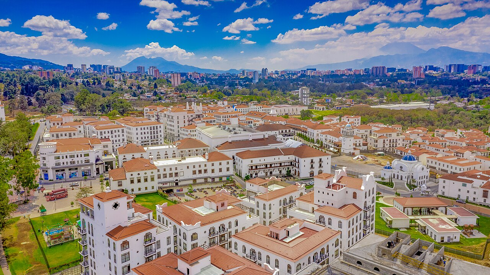
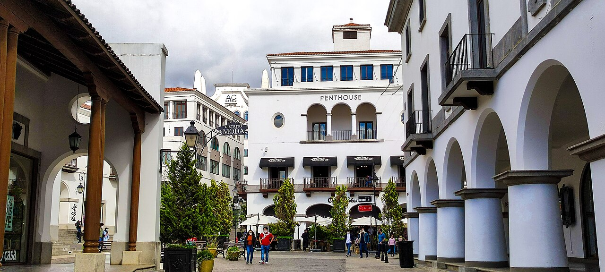
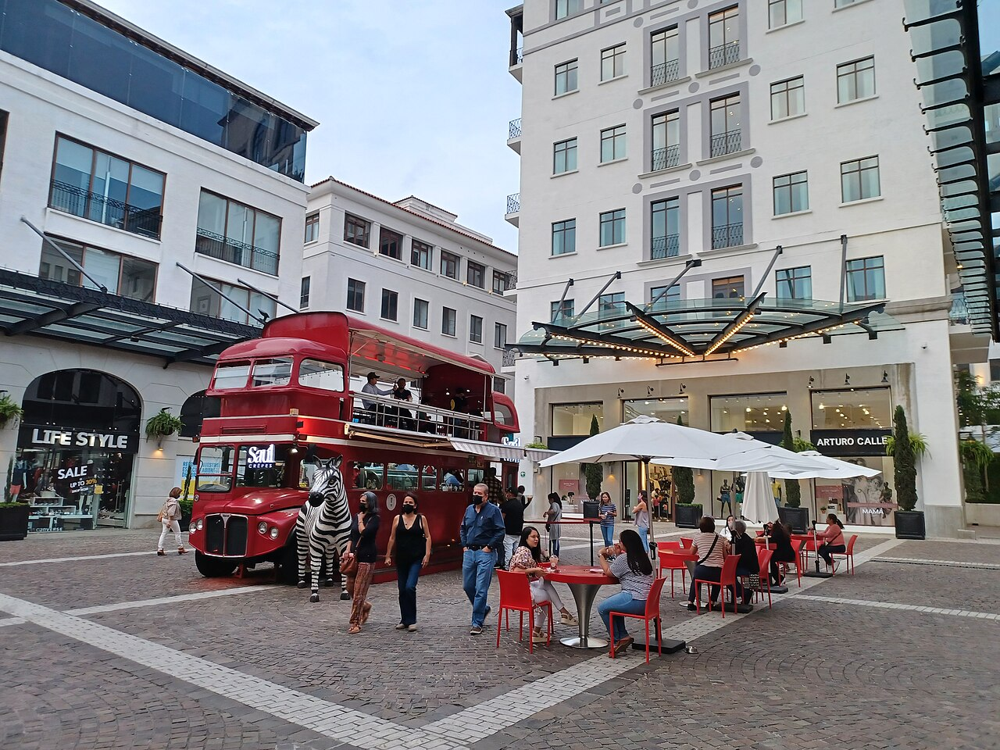
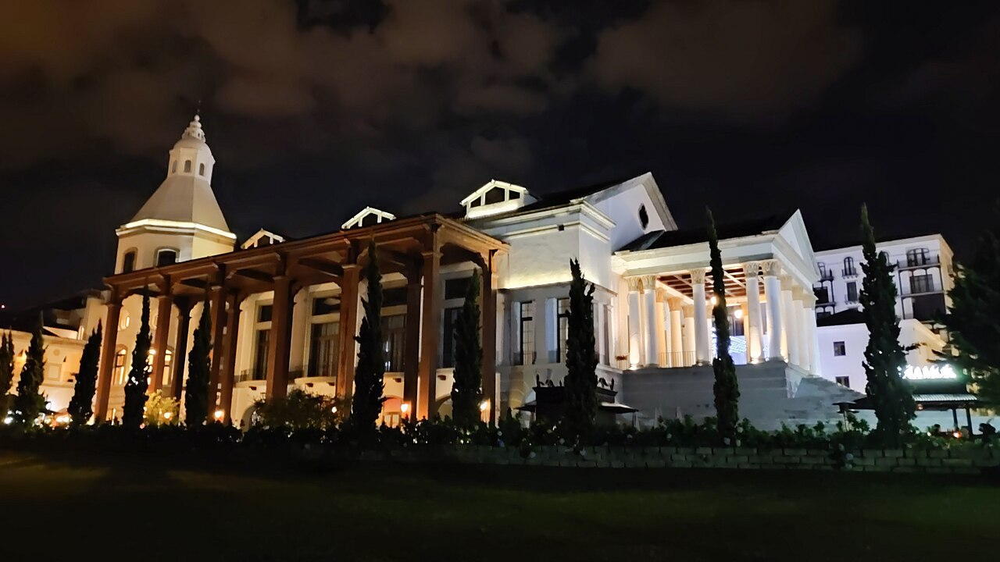

# Práctica 2, Red de servicios comunes de Ciudad Cayalá

| Dato | Valor |
|---|---|
| Estudiante | Mariano Roberto Rac Noguera |
| Carné | 202101149 |
| Carrera | Ingeniería en Ciencias y Sistemas |
| Universidad | Universidad de San Carlos de Guatemala (USAC), Facultad de Ingeniería |
| Curso | Redes de Computadoras 1 |
| Semestre | Segundo semestre 2026 |

## Descripción de la práctica

La práctica diseña e implementa en Cisco Packet Tracer la red de servicios comunes de Ciudad Cayalá. La red pertenece a la empresa administradora del complejo y cubre el Wi-Fi público, la señalización digital, las cámaras, el control de accesos, la administración de edificios y los parqueos de cinco zonas (Paseo Comercial, Centro de Control, Distrito Moda, Distrito Empresarial y Lirios Residencial). Cada tienda, oficina o apartamento tiene su propio proveedor de internet, por lo que no forma parte de esta red.

La topología es híbrida y tiene 15 switches. En el centro hay un triángulo redundante entre el switch núcleo de capa 2 (un Cisco 3560) y los switches principales de las zonas 1 y 4, y las zonas 3 y 5 se conectan en estrella. La práctica usa VLANs por zona (19, 29, 39, 49 y 59), VLAN nativa 99, VLAN Blackhole 999, VTP con dominio 202101149, EtherChannel PAgP y Rapid PVST+ con un root bridge por zona.

Por indicación del auxiliar del curso, la práctica es solo de capa 2. No hay enrutamiento entre VLANs y todas las PCs están en la misma red, 192.168.49.0/24 (49 son los dos últimos dígitos del carné), con un rango reservado por zona. Así, lo único que impide un ping entre zonas es la separación de VLANs, y un ping fallido entre zonas es la prueba directa de que la segmentación funciona.

## Ciudad Cayalá

Ciudad Cayalá es un desarrollo urbano de uso mixto en la zona 16 de la Ciudad de Guatemala, sobre el Blvd. Rafael Landívar, con arquitectura de inspiración neoclásica y calles peatonales. Según su [sitio oficial](https://www.cayala.com), reúne más de 200 comercios en las categorías Comercio, Gastronomía, Entretenimiento, Salud y Servicios. Las fuentes públicas, entre ellas el artículo de Wikipedia sobre [Ciudad Cayalá](https://es.wikipedia.org/wiki/Ciudad_Cayal%C3%A1), describen Paseo Cayalá como su corazón comercial, junto con Distrito Moda, un Distrito Empresarial de 13 edificios de oficinas, el hotel AC Marriott y el residencial Lirios de Cayalá de 28 condominios. Para el material oficial y actualizado del complejo, como planos, directorio y eventos, se recomienda consultar directamente [cayala.com](https://www.cayala.com).

*Figura 1. Vista aérea de Ciudad Cayalá con sus edificios de techos rojos y la ciudad al fondo. Foto de Juan Francisco, licencia [CC BY-SA 2.0](https://creativecommons.org/licenses/by-sa/2.0/), vía [Wikimedia Commons](https://commons.wikimedia.org/wiki/File:Ciudad_Cayala_-_Guatemala_City.jpg). Imagen redimensionada a 1280 px de ancho.*

*Figura 2. Calle peatonal con arcadas y comercios, el tipo de espacio que cubre la Zona 1 (Paseo Comercial). Foto de Rene Hernandez, licencia [CC BY-SA 2.0](https://creativecommons.org/licenses/by-sa/2.0/), vía [Wikimedia Commons](https://commons.wikimedia.org/wiki/File:Ciudad_Cayal%C3%A1_-_Guatemala_CA.jpg). Imagen redimensionada a 1280 px de ancho.*

*Figura 3. Plaza con terrazas y comercios en Ciudad Cayalá. Foto de Simon Burchell, licencia [CC BY-SA 4.0](https://creativecommons.org/licenses/by-sa/4.0/), vía [Wikimedia Commons](https://commons.wikimedia.org/wiki/File:Ciudad_Cayal%C3%A1,_Guatemala_City_02.jpg). Imagen redimensionada a 1280 px de ancho.*

*Figura 4. Edificio iluminado de Ciudad Cayalá de noche. Foto de Rene Hernandez, licencia [CC BY-SA 2.0](https://creativecommons.org/licenses/by-sa/2.0/), vía [Wikimedia Commons](https://commons.wikimedia.org/wiki/File:Night_in_Ciudad_Cayal%C3%A1_-_51367191930.jpg). Imagen redimensionada a 1280 px de ancho.*

Las cuatro fotografías se distribuyen bajo la misma licencia CC BY-SA de su original, como exige la cláusula de compartir igual.

## Contenido de la carpeta

| Archivo | Descripción |
|---|---|
| [Manual_Tecnico.md](Manual_Tecnico.md) | Implementación completa, tabla de VLANs, direccionamiento, alcance de capa 2, Spanning Tree y root bridges, dominios de colisión y de broadcast, justificación de la topología y presupuesto |
| [Informe_Desarrollo.md](Informe_Desarrollo.md) | Implementación en orden, problemas encontrados, soluciones y capturas de las pruebas |
| [Cayala.pkt](Cayala.pkt) | Topología en Cisco Packet Tracer |
| [Images/](Images/) | Diseño de la topología, capturas de las pruebas y fotografías de Cayalá |
| [SW_CC.conf](SW_CC.conf) | VTP servidor (switches principales) |
| [SW_AC.conf](SW_AC.conf) | VTP cliente (switches de acceso) |
| [SW_CC_VLANS.conf](SW_CC_VLANS.conf) | Creación de VLANs en SW_CC |
| [SW_CC_vtP.conf](SW_CC_vtP.conf) | Hostname, Rapid PVST+, prioridades STP y Blackhole de SW_CC |
| [SW_CC_TRUNKS.conf](SW_CC_TRUNKS.conf) | EtherChannel y troncales de SW_CC |
| [SW_PASEO.conf](SW_PASEO.conf) | EtherChannel y troncales de SW_PASEO |
| [SW_EMP.conf](SW_EMP.conf) | Troncales de SW_EMP |
| [SW_LIRIOS.conf](SW_LIRIOS.conf) | Troncales de SW_LIRIOS |
| [SW_MODA.conf](SW_MODA.conf) | Archivo de SW_MODA (vacío) |
| [SW_MODA_ALLOWD_VLANS.conf](SW_MODA_ALLOWD_VLANS.conf) | VLANs permitidas en SW_MODA |
| [AC_EMP3.conf](AC_EMP3.conf) | Plantilla de switch de acceso |
| [VOLVIENDO_A_CAPA2.conf](VOLVIENDO_A_CAPA2.conf) | Desactiva el enrutamiento y elimina las SVIs de SW_CC para dejarlo solo en capa 2 |
